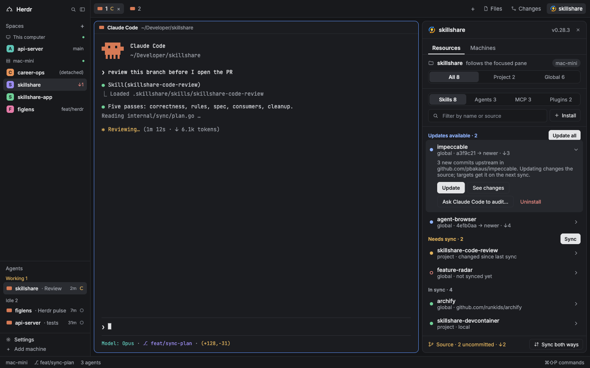

# herdr-mods

Mods and layouts for the [Herdr](https://herdr.dev) desktop app. Each folder is one share: grab the ones you want.

## skillshare-wsl

The [skillshare](https://github.com/runkids/skillshare) panel for Herdr, made to work when Herdr runs on Windows and your agents run in WSL. It shows the skills, agents, MCP servers, plugins and hooks your skillshare source holds, what needs an update or a sync, and acts on them.



Changes from upstream's `skillshare` mod:

- On Windows, the panel runs skillshare inside WSL (`wsl.exe -d Ubuntu`), and converts Windows folder paths to `/mnt/<drive>/...`. Spaces on other machines work as upstream.
- Expanded skill and agent rows show the skill's description from its `SKILL.md` frontmatter.

Needs the skillshare CLI installed in WSL (`~/.local/bin/skillshare`) and set up with `skillshare init`. For a distro other than `Ubuntu`, change `WSL_DISTRO` at the top of `mods/skillshare-wsl/main.js`.

Based on runkids/skillshare's `herdr/skillshare` (MIT, see `skillshare-wsl/LICENSE`).

## Install

### Tell your agent

skillshare-wsl:

```text
Read ~/.config/herdr-app/AGENTS.md, then add this layout: https://github.com/jbped/herdr-mods/tree/main/skillshare-wsl
```

### By hand

Copy a share's `mods/<name>/` folders to `~/.config/herdr-app/mods/` and its `layouts/` files to `~/.config/herdr-app/layouts/`, then run `herdr-app check ~/.config/herdr-app/mods/<name>` for each mod.

## Working on these

Herdr only hot-reloads mods that are real folders in `~/.config/herdr-app/mods/`, so edit them there, not in this repo. Linked folders (junctions) load but don't reload on save. Before committing, copy the changes back:

```sh
./sync.sh                  # every share
./sync.sh skillshare-wsl   # one share
```

`sync.sh` copies each mod and layout a share folder already has from the config folder, skipping the files Herdr generates (`gpui-kit.d.ts`, `jsconfig.json`). On WSL it finds the Windows config folder on its own. Set `HERDR_HOME` to use another one.
