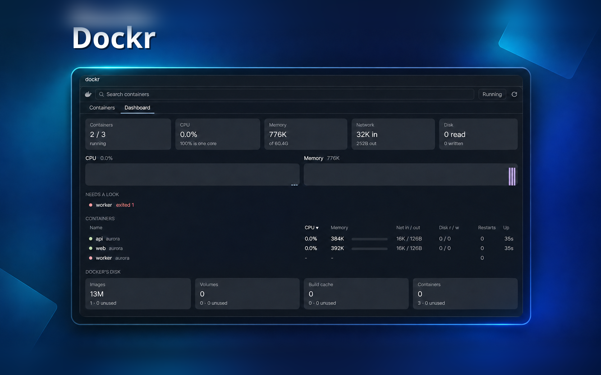
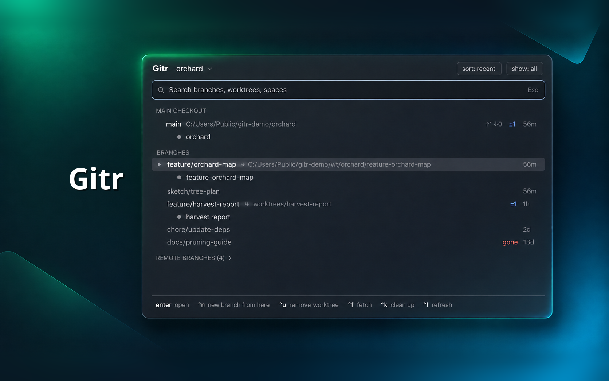
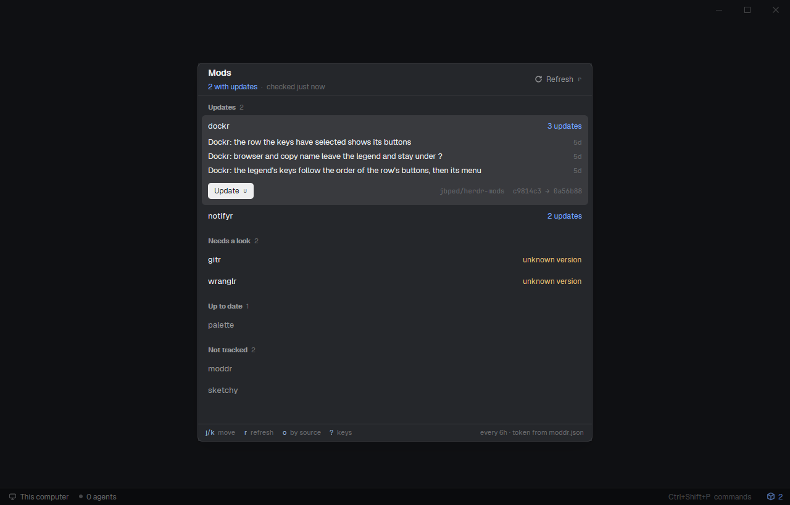
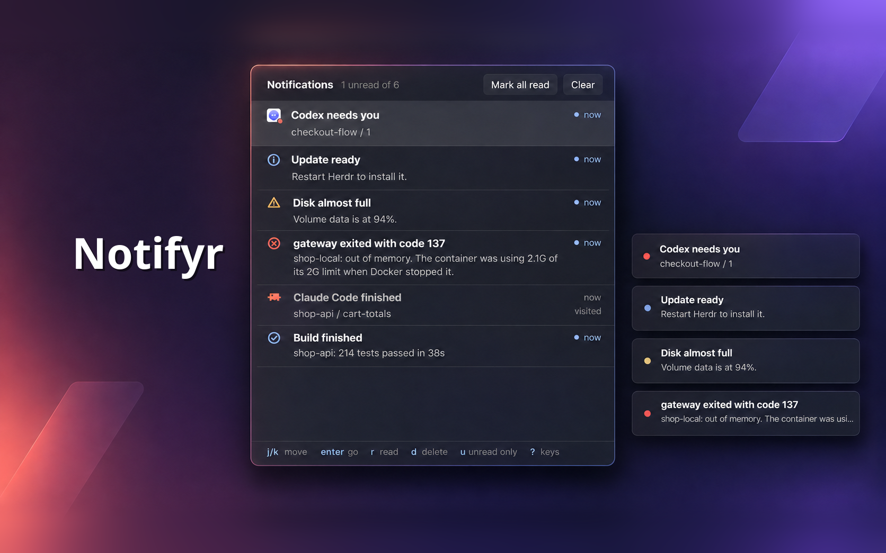
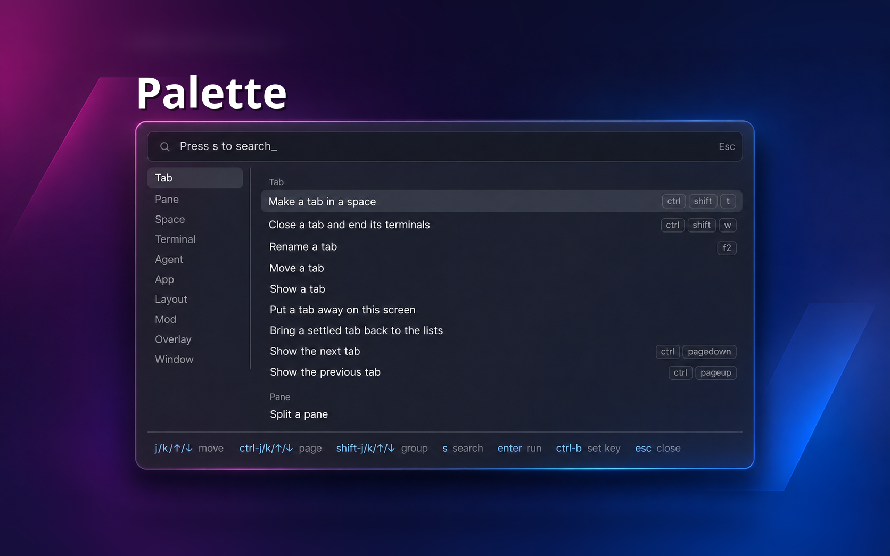
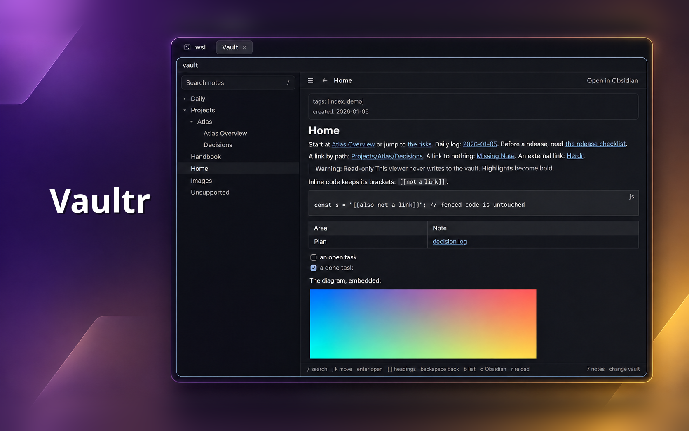
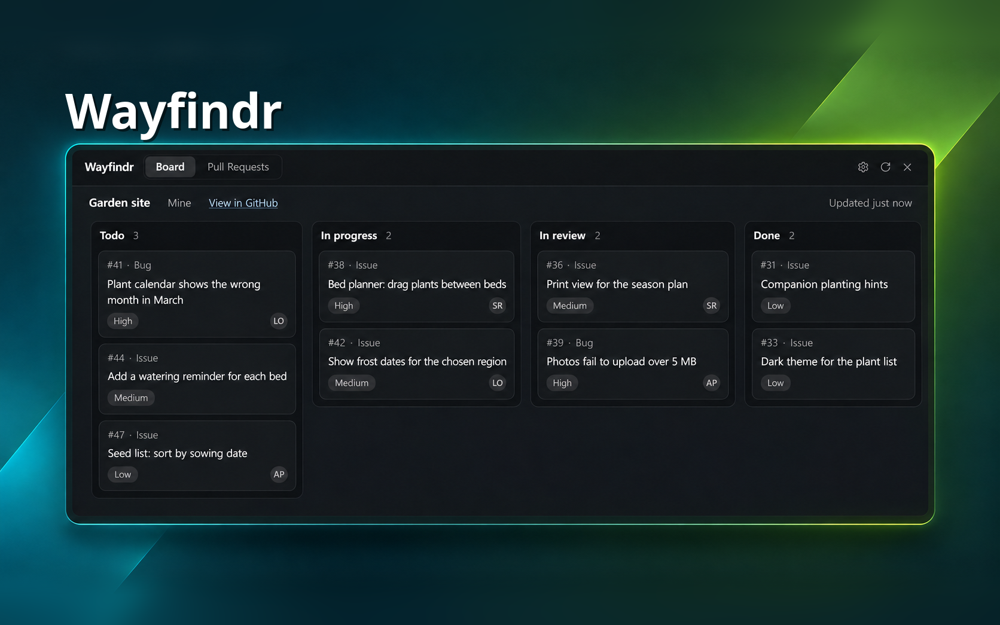
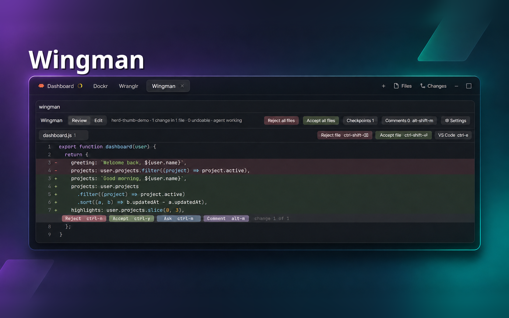
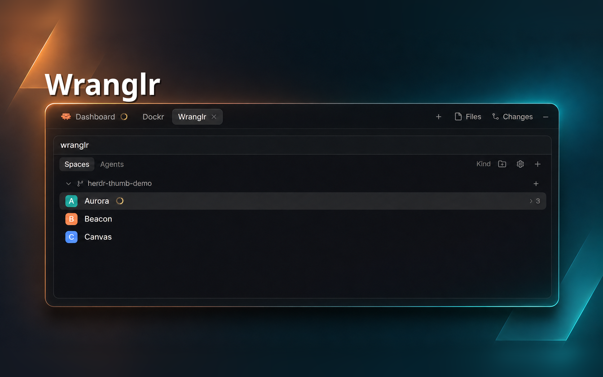

# herdr-mods

Mods for the [Herdr](https://herdr.dev) desktop app. Each folder is one mod, and its page says what it does, what it needs and how to install it.

<!-- shares:start -->

## Mods

### [agents-plus](agents-plus/)

[](agents-plus/)

Herdr's Agents list with Claude Code's in-process subagents nested under the session that started them.

```text
Read ~/.config/herdr-app/AGENTS.md, then add this mod: https://github.com/jbped/herdr-mods/tree/main/agents-plus
```

---
### [Brunr](brunr/)

[](brunr/)

A dialog that lists your Bruno Collections as a tree, runs their Requests with the Bruno CLI and shows each Response beside the tree.

```text
Read ~/.config/herdr-app/AGENTS.md, then add this mod: https://github.com/jbped/herdr-mods/tree/main/brunr
```

---
### [Dockr](dockr/)

[](dockr/)

A dialog that lists Docker containers and sets which checkout each compose service runs from: the main checkout or a git worktree.

```text
Read ~/.config/herdr-app/AGENTS.md, then add this mod: https://github.com/jbped/herdr-mods/tree/main/dockr
```

---
### [Gitr](gitr/)

[](gitr/)

One Repo at a glance: its Main checkout, Worktrees and Branches, the spaces on each, and one key to go to, start or clean up work.

```text
Read ~/.config/herdr-app/AGENTS.md, then add this mod: https://github.com/jbped/herdr-mods/tree/main/gitr
```

---
### [Moddr](moddr/)

[](moddr/)

Finds where each of your mods came from on GitHub, tells you when one has an update, and installs it.

```text
Read ~/.config/herdr-app/AGENTS.md, then add this mod: https://github.com/jbped/herdr-mods/tree/main/moddr
```

---
### [Notifyr](notifyr/)

[](notifyr/)

A log of every notification Herdr shows, with a bell that counts the new ones and a list to read them later.

```text
Read ~/.config/herdr-app/AGENTS.md, then add this mod: https://github.com/jbped/herdr-mods/tree/main/notifyr
```

---
### [Palette](palette/)

[](palette/)

A command palette that mods can add entries to: your entries, each mod's entries, then every Herdr command with its key.

```text
Read ~/.config/herdr-app/AGENTS.md, then add this mod: https://github.com/jbped/herdr-mods/tree/main/palette
```

---
### [tabs-plus](tabs-plus/)

[](tabs-plus/)

Herdr's tab bar with side-panel buttons for Wingman, Vaultr and Wayfindr, and a side panel that is remembered for each space.

```text
Read ~/.config/herdr-app/AGENTS.md, then add this mod: https://github.com/jbped/herdr-mods/tree/main/tabs-plus
```

---
### [Vaultr](vaultr/)

[](vaultr/)

Read your Obsidian vault inside Herdr: the folder tree, name search, links that open in place, images and backlinks.

```text
Read ~/.config/herdr-app/AGENTS.md, then add this mod: https://github.com/jbped/herdr-mods/tree/main/vaultr
```

---
### [Wayfindr](wayfindr/)

[](wayfindr/)

Your Boards and Pull Requests from GitHub, Azure DevOps and ClickUp inside Herdr, with a space started from a Ticket or a Pull Request.

```text
Read ~/.config/herdr-app/AGENTS.md, then add this mod: https://github.com/jbped/herdr-mods/tree/main/wayfindr
```

---
### [Wingman](wingman/)

[](wingman/)

A review pane for what coding agents change: whole-file diffs with Accept and Reject per change, per file or for everything.

```text
Read ~/.config/herdr-app/AGENTS.md, then add this mod: https://github.com/jbped/herdr-mods/tree/main/wingman
```

---
### [Wranglr](wranglr/)

[](wranglr/)

A spaces sidebar that sorts spaces into Groups: one per Repo, one per Workspace, and Custom groups you fill by hand.

```text
Read ~/.config/herdr-app/AGENTS.md, then add this mod: https://github.com/jbped/herdr-mods/tree/main/wranglr
```

---
<!-- shares:end -->

## License

MIT, see [`LICENSE`](LICENSE). A folder with its own license file keeps that license for the code it came with: `agents-plus` and `wranglr` started from Herdr's mods (Apache-2.0).
