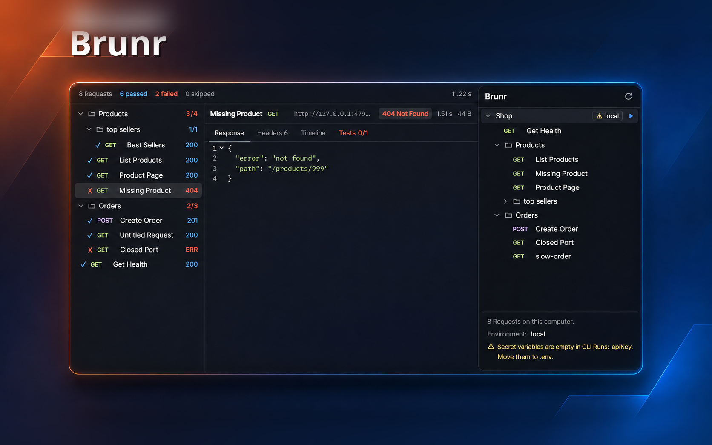

# Brunr

A dialog that lists your Bruno Collections as a tree, runs their Requests with the Bruno CLI and shows each Response beside the tree.



## Features

- **One dialog.** The Collection tree on the left and the last Run's Response on the right. It opens over the window or as its own tab, as its settings say, and `f` fills the window.
- **Collection tree.** Collections, folders and Requests in Bruno's sidebar order, with method badges in the Herdr theme's colours. A selected Request shows its method and URL, and a change to a Collection on this computer shows at once.
- **Run a Request.** Double-click or press `enter`. The Response shows its Response, Headers, Timeline and Tests views.
- **Run with other values.** `p` asks for a value for each `{{variable}}` in a Request's URL and uses them for that Run only.
- **Folder and Collection Runs.** After a confirmation, with a summary line, a pass or fail mark per Request, the first failure selected and a list you can search, filter and sort. Assertion and test results are listed under Tests. While the Run is in progress, the tree and the Response show how many Requests have finished and which one runs now.
- **Environments.** Pick one per Collection from a chip on its row. The choice is remembered, and an Environment with secret variables carries a warning.
- **Global environments.** Pick one per Bruno workspace for all of its Collections.
- **Other Machines.** A Collection on WSL or an ssh Machine is listed and run there. Machines get their own headings.
- **Both formats.** The OpenCollection YAML format and the bru format, in one tree.
- **Open file, Copy URL, Copy path and Open Bruno.** Show a Request's file, copy its URL or path, or start Bruno desktop.
- **Keyboard and settings.** Move, fold, run and pick without the mouse, and `?` shows every key. The gear or `,` opens the settings: open as a tab or a dialog, open the dialog in full screen, hide the key hints, and switch any shortcut off or move it to another key.
- **Setup help.** When `bru` is missing on a Machine, the dialog says what to install and has a Copy button.

## Needs

- Herdr.
- The Bruno CLI (`npm i -g @usebruno/cli`, which needs Node 18 or later) on every Machine that holds a Collection.
- Bruno desktop is optional. Its workspace file is where Collections on this computer are found.
- It runs `bru`, `node --version` and a file-listing command (`sh`, or `powershell` on Windows) on a Collection's Machine. On another Machine it also runs `cat` and `rm`. Open Bruno starts the desktop app.
- It reads Collection files, Bruno desktop's `workspace.yml` and `brunr.json`. It writes a temporary report file per Run and deletes it. It never reads `.env`.
- A Run sends the Collection's requests to whatever they point at.

## Install

Tell your agent:

```text
Read ~/.config/herdr-app/AGENTS.md, then add this mod: https://github.com/jbped/herdr-mods/tree/main/brunr
```

Or by hand:

1. Copy `mods/brunr/` to `~/.config/herdr-app/mods/`.
2. Merge `keys.json` into `~/.config/herdr-app/keys.json`. It binds `ctrl-shift-u`.
3. Run `herdr-app check ~/.config/herdr-app/mods/brunr`.

## Use

`ctrl-shift-u` opens Brunr. Pressed again, it closes the dialog, or goes back from the tab. Click selects a row and double-click runs a Request or folds a folder. Right-click opens a row's menu, with Copy URL and Copy path. The Run button at the top runs the selected Request, folder or Collection, and the chip on a Collection picks its Environment.

| Key | Action |
|---|---|
| `up` / `down`, or `k` / `j` | move |
| `left` / `right`, or `h` / `l` | fold / unfold |
| `enter` | run a Request, or fold a folder |
| `r` | run the Request, folder or Collection |
| `e` | pick the Environment |
| `ctrl-l` / `ctrl-h` | keyboard to the Response / back to the tree |
| `?` | show or hide every key |
| `esc` | close |

Collections on other Machines need `brunr.json`. The config file, every key, settings, secrets, Runs, limits and how it works: [`mods/brunr/README.md`](mods/brunr/README.md).
