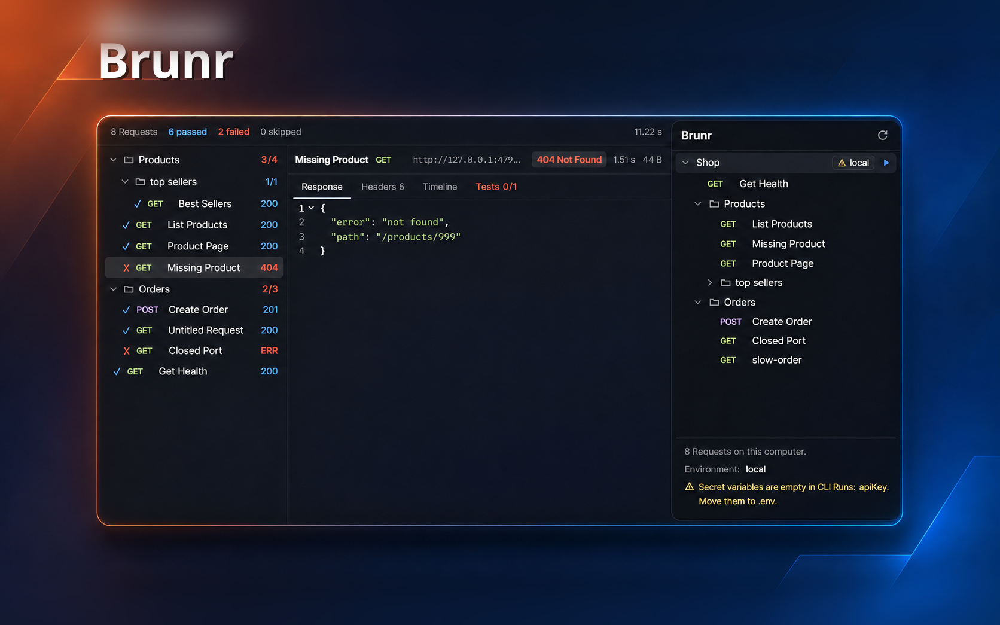

# Brunr

A side panel that lists Bruno Collections as a tree in the Herdr theme's colours, as Bruno's own sidebar does. Double-click a Request and the Bruno CLI runs it. The Response opens in a pane beside your terminal with Response, Headers, Timeline and Tests views. A folder or Collection Run shows a summary and a list of Requests with pass or fail marks, grouped under their folders. Each Collection has an Environment chip, and a Global environment row sits above the Collections of a Bruno workspace.



## What you see

The preview shows a Response pane on the left and the Brunr panel on the right, 320px wide. The panel lists a made-up "Shop" API with a `local` chip that carries a warning icon, its "Products" and "Orders" folders unfolded and the nested "top sellers" folder folded. The Response pane shows a Run of the whole Collection: "8 Requests, 6 passed, 2 failed, 0 skipped, 11.22 s". Its Request list is a tree: "Products" with `3/4` in the fail colour, "top sellers" nested under it with `1/1`, "Orders" with `2/3`, and "Get Health" at the top level. The failed "Missing Product" is selected and shown beside the list with `404 Not Found`, 1.51 s, 44 B, "Headers 6", "Tests 0/1" and its JSON body. The panel is one block in your own layout. It has an 8px radius, a 1px border in `border` (`accent` while it holds the keyboard), a `chrome` fill and 12.5px text in `foreground`. Top to bottom:

- **Header**, 38px, with a bottom border: "Brunr" in 13px semibold, then a 13px turning ring in `dim` while Collections load, then a 22px refresh icon button in `muted`.
- **Notices**, only when there are any, each in an 8px margin with 10px by 7px padding, a 6px radius and 11.5px text on `raised`:
  - A config problem: a 13px warning icon and the sentence, in `blocked`. For example "brunr.json is not valid JSON" or "No Bruno Collection in /srv/shop on buildbox".
  - A missing CLI card with a 1px `border` outline: the title "No Bruno CLI on this computer. Runs are off." in `ansi3` and semibold, the step in `muted`, the command in the terminal font at 11px, and a 22px "Copy" button on `solid`.
- **The tree**, the only part that scrolls, with 4px side padding. Rows are 26px high, 6px apart inside, with a 5px radius and an indent of 14px per level. A hovered row is on `hover`. The selected row is on `hover`, or on `selected` while the panel holds the keyboard.
  - **Machine heading**, 24px, only when Collections sit on more than one Machine: the name in upper case, 10.5px semibold `dim`. "This computer" names this one.
  - **Global environment row**, only for a workspace that has Global environments: a 13px globe icon and the label in `muted`, and on the right a chip with the chosen name or "None".
  - **Collection row**: a 14px fold arrow in `dim`, the name in medium weight, a 12px turning ring while loading, a `blocked` warning icon when the folder cannot be read (the tooltip has the reason), a pill 16px high with the number of files that could not be read (10px `blocked` on `raised`), and the Environment chip.
  - **Environment chip**: 18px high, at most 120px wide, a 1px `border` outline, a 4px radius and 10.5px text. It shows the Environment name in `foreground`, or "No Environment" in `dim`. An `ansi3` warning icon, 11px, comes first when the Environment has secret variables.
  - **Folder row**: a fold arrow, a 13px folder icon in `muted` and the name.
  - **Request row**: a 14px spacer, a 34px method badge and the name. The badge is 10px semibold. GET is `ansi2`, POST `ansi5`, PUT `ansi3`, PATCH `ansi6`, DELETE `ansi1` (shown as "DEL"), and any other method is `muted` (OPTIONS shows "OPT", GRAPHQL "GQL" and CONNECT "CONN").
  - **Play button**, 18px, at the right of a folder or Collection row while it is hovered or selected. It is a 10px play icon in `done`, or in `dim` and inert when Runs are not possible. The row that is running shows a 12px turning ring in `working` instead. A running folder or Collection row shows "4/16" in 10.5px `muted` before the ring, and the Request running now shows the ring on its own row when it is visible.
  - **Empty states** in 12px `dim`: "Reading Collections…", "No Bruno workspace at <path>. Set "workspace" or "collections" in <brunr.json path>." and "The workspace lists no Collections. Add one in Bruno, or list one under "collections" in <brunr.json path>."
- **Footer**, with a top border, 12px by 9px padding, a 5px gap and 11.5px text:
  - During a folder or Collection Run, first an 11px turning ring in `working` and "Running: Slow 05" in `muted`, when the running Request is known.
  - Nothing selected, or a Machine heading: "Click selects. Double-click or Enter runs a Request." in `dim`.
  - A Request: its method badge (40px) and its URL in the terminal font at 11px.
  - A folder: "4 Requests. r or the play button runs them." in `dim`.
  - A Collection: "4 Requests on this computer." in `dim`, in `blocked` the reason the folder cannot be read, and the first five unreadable files as `path: message`.
  - Any row of a Collection ends with "Environment:" and the name, and for an Environment with secrets an `ansi3` line "Secret variables are empty in CLI Runs: apiKey. Move them to .env."

The Response pane is a pane in the tab, on `background` with 12.5px text.

- **Nothing yet**: "No Response here yet. Run a Request from the Brunr panel." in `dim`.
- **Running**: the top line, then a 22px turning ring in `working` and "Running List Products against local…" in `muted`.
- **Folder or Collection Run in progress**: a 30px line with a 12px turning ring in `working` and "4 of 16" in `muted`, then the list of finished Requests in the 28px row look below (✓ or ✗ from the HTTP status, method badge, name, status), and last the running Request with an 11px turning ring in place of the mark and its name in `muted`. The list is grouped by folder as in the result below. A folder's total is its planned number of Requests, and each folder holding the running Request has an 11px turning ring left of its count. Request rows cannot be selected. Folder rows fold. Beside or below the list, the 22px ring and "Running Slow lane against local…". When the Run ends, the result replaces it.
- **Top line**, 40px, with a bottom border: the Request name in semibold (at most 220px), a 44px method badge, the URL in the terminal font at 11.5px in `muted`, then a 20px chip on `raised` with the status and its text ("404 Not Found", semibold, 11.5px, `done` for 2xx, `ansi3` for 3xx, `blocked` for anything else and "Error" when there was no response), then the time ("4 ms", "1.24 s") and size ("44 B", "1.2 KB") in `muted`.
- **View tabs**, 32px: Response, "Headers 6", Timeline and "Tests 0/1". The current one has a 2px `accent` bottom border. Tests is `blocked` when any assertion or test failed.
  - **Response**: a read-only editor at 12px in the terminal font with soft wrap. Syntax colours are `ansi5` keywords, `ansi2` strings, `dim` comments, `ansi4` functions, `ansi3` types, `ansi1` numbers and `ansi6` constants and booleans. JSON is pretty-printed. It says "No body" or the error text when there is none.
  - **Headers**: rows with the name in `muted` in a 200px column and the value beside it.
  - **Timeline**: the method and resolved URL, the request headers in `muted`, "Body" and the request body when there is one, then the status and time.
  - **Tests**: a row per assertion or test with a ✓ in `done` or ✗ in `blocked`, its name in the terminal font, "assertion" or "test" in `dim`, and the error in `blocked`. "No assertions or tests." when there are none.
- **Folder or Collection Run**: a 30px summary line first, "5 Requests", "3 passed" in `done`, "1 failed" in `blocked`, "1 skipped" in `ansi3` (a zero count is `dim`) and the total time on the right in `dim`. Then a list of 28px rows: a ✓ or ✗, a 34px method badge, the name, and the status colored as above, or "ERR" with no response. The list is 240px wide at the left with a 1px right border when the pane is at least 720px wide. Otherwise it sits on top, as high as its rows up to 180px. The first failed Request is selected, or the first when none failed. The top line and tabs show the selected one.
- **Run list as a tree**: the list groups Requests under their folders. A 28px folder row comes before a folder's first Request: a 12px chevron in `dim` (down when unfolded, right when folded), a 13px folder icon in `muted`, the folder's name (its folder file's name, else the directory name) and at the right `<passed>/<total>` in 10.5px, `blocked` when any Request beneath it failed, else `done`. Each depth indents rows by 14px. The Run target gets no row, so a "Products" Run shows "top sellers" as a folder row and the Requests directly in Products at the top level. A Run with every Request directly in its target has no folder rows and looks like a flat list. Requests keep the Run order, and a folder whose Requests are not consecutive gets a new row each time it starts again.
- **Run list toolbar**: for a Run with more than one Request, a 36px row with a bottom border between the summary line and the list, across the pane. Left to right: a 24px text field with the placeholder "Search" that takes the free width and shrinks first, then four 24px controls with a 1px `border` and 11.5px text that cycle on click. Each shows a fixed label in `muted`, then its current value: "Result" with "All", "Failed" or "Passed", then "Status" with "Any", "2xx", "3xx", "4xx", "5xx" or "Error", then "Method" with "Any" and the methods that occur in the Run (GET, POST, PUT, PATCH, DELETE, HEAD, OPTIONS in that order, then any others alphabetically), then "Sort" with "Run order", "Slowest", "Fastest", "Status" or "Name". The defaults read "Result All", "Status Any", "Method Any" and "Sort Run order". A control away from its first value has its value and border in `accent`, and the field while it holds text has its text and border in `accent`. The label stays `muted`. While a filter is on, the summary line adds "showing 2 of 8" in `accent`. When nothing matches, the list shows "No Requests match." in `dim` and a "Clear filters" button in `accent`, and the views show "No Requests match.". While the Run is in progress the toolbar is drawn in `dim` and does nothing.
- **Message**: when the CLI fails or sends nothing, the top line and a box on `surface` with a 1px `border`, a 6px radius and 12px margin, holding the message in the terminal font at 11.5px, line by line.
- **File**: a 36px bar with "Read only" in 11px `dim` and the file's path, then the editor.

Popups and dialogs:

- **Row menu**, 220px wide, 28px items with a hint on the right in 10.5px `dim` (Enter, o, r, e, b) and 1px separators. A disabled item is `dim`. Items: Run, Open file, "Run folder" or "Run Collection", Environment, "Global environment", "Open Bruno" (only on this computer), Copy URL, Copy path, Reload.
- **Environment picker**, 300px wide: a 34px title "Environment of Shop" with "Esc" at the right, then 28px rows with a ✓ in `accent` on the current one. "No Environment" is `muted`. A row for an Environment with secrets is 44px high with an `ansi3` warning icon and the warning text under the name. A picker opened by a key is a dialog in the middle, and one opened by a click is a popup at the pointer.
- **Global environment picker**, the same, titled "Global environment", with "No Global environment" first.
- **Confirm dialog**, 440 by 170px, Herdr's own `confirm` mod: `Run 4 Requests in "Products" against local?` and "The Bruno CLI sends them one after another. Enter runs, Esc cancels." On another Machine the second line ends "on <machine>."

## How it behaves

Brunr shows Run results, not agent statuses. It does not touch agents.

- Collections start unfolded and folders folded. Folds are remembered.
- Click selects a row. Double-click runs a Request, or folds a Collection or folder. The arrow folds. The chip opens the picker. Right-click opens the menu. Selecting a row never runs it.
- A Collection on this computer is watched. A change reloads that Collection. A Collection on another Machine reloads every 30 seconds.
- Run states: running (turning rings on the row and in the pane, other Run buttons inert with the tooltip "Another Run is in progress"), done with all Requests passing or not, and a message for a CLI failure or timeout ("The Run timed out.").
- A folder or Collection Run shows progress while it runs: the count on the row and in the pane, the finished Requests as they finish with a mark from their HTTP status, and the running Request in the pane, on its tree row and in the footer. Assertion results appear only when the Run ends.
- Clicking a folder row in the Response pane's list folds or unfolds it. Folders start unfolded. Folds last for one Run and reset when a new Run starts. When the Run ends, the folders holding the selected and the first failed Request unfold. The live list and the result use the same rows, so the list does not jump when the Run ends.
- The toolbar filters a finished Run's list by text (every word in the name, path or URL, ignoring case), by result (pass and fail as the marks show them, never the HTTP status alone) by status class and by HTTP method, combined. It sorts by Run order, slowest or fastest response time, status number or name ignoring case, inside each folder, with folders in Run order, no-response Requests last and ties in Run order. A folder with nothing left is hidden, and folder counts always describe the whole Run. A hidden selection moves to the first Request shown. "Clear filters" resets the four filters and keeps the sort. The filters and sort stay for later Runs in the same pane and are never saved. When a new Run ends and the chosen method does not occur in it, the method filter goes back to "Any". The live list ignores them.
- A Request Run starts at once. A folder or Collection Run asks first. A folder with no Requests shows the toast "Nothing to run".
- The Response goes to the focused tab's Response pane. A tab without one gets a pane split to the right of the focused pane. With no focused pane, a new tab opens. The pane's content goes when the pane closes.
- `ctrl-shift-u` is a toggle. It shows a hidden panel and gives it the keyboard. It hides a shown panel, handing the keyboard back when the panel held it and leaving it alone otherwise. Keys in the panel: `up`/`k`, `down`/`j`, `home`, `end`, `left`/`h`, `right`/`l`, `enter`, `r`, `e`, `o`, `b`, `esc`/`q`. A key with `ctrl`, `alt` or the platform key is ignored.
- `o` shows the Request's file in the pane, read only. `b` and "Open Bruno" start Bruno desktop and show the toast "Bruno desktop was not found" when it is missing.
- Copy URL and Copy path put text on the clipboard.
- A chosen Environment of the Collection is used by every Run of it. A Global environment is added to Runs of the workspace's Collections.

## Built from

Layout block, added to the user's layout in the row that holds the tab block, on the right:

```json
{ "id": "brunr", "type": "block", "content": { "mod": "brunr" }, "size": { "px": 320 } }
```

One mod, `brunr`, in `mods/brunr/`. Its `mod.json` has `"place": "right"`, `"size": 320`, `"title": "Brunr"`, `"focusable": true` and an overlay `{ "kind": "popup", "at": "top", "offset": 0, "width": 1, "height": 1, "frame": "none" }`. Its palette entries are "Brunr: Toggle" (`layout.toggle` with `{ "id": "brunr" }`), "Brunr: Keys" (`mod.open` with `{ "name": "brunr" }`) and "Brunr: Reload" (`brunr.reload`).

One entry, `main.js`, draws every part. The copy is chosen by `props()`:

- `{ "view": "response", "tab": <tab> }`: the Response pane.
- `{ "picker": {...} }` and `{ "menu": {...} }`: the popups over the panel.
- `{ "overlay": <id> }` alone: the pass-through the key opens. It shows the panel if hidden, asks it to take the keyboard and closes at once.
- No props: the panel.

Modules: `main.js`, `panel.js`, `response.js`, `popup.js`, `tree.js`, `runtree.js`, `runfilter.js`, `store.js`, `sources.js`, `machine.js`, `plan.js`, `progress.js`, `report.js`, `parser.js`, `yaml.js`. Only `machine.js` calls `exec`, `readTextFile`, `watchFolder` and `fs`. `progress.js` imports nothing. `runtree.js` builds the Response pane's Run list rows and imports only `progress.js`. `runfilter.js` filters and sorts a finished Run's list and imports only `runtree.js`.

Keys, in `keys.json`:

```json
{ "global": { "ctrl-shift-u": "mod.open:brunr" }, "mod:brunr": { "ctrl-shift-u": "brunr.hide" } }
```

Config, `brunr.json` in the app home: `{ "workspace": "<path of a workspace.yml>", "collections": [ { "machine": "<name, optional>", "path": "<Collection root or a folder of them>" } ] }`.

Herdr calls: `appHome`, `home`, `checking`, `exec`, `readTextFile`, `watchFolder`, `window`, `props`, `layout`, `focused`, `panes`, `settings`, `theme`, `shared`, `setShared`, `notify`, `openOverlay`, `closeOverlay`, `nextCommand` and `run`. Commands run: `layout.show`, `layout.hide`, `pane.go` (`left` and `right`), `pane.split` (`direction: "right"`, `mod: "brunr"`, `props: { view: "response", tab }`) and `tab.new`. Commands it receives through `nextCommand`: `reload`, `focus`, `hide` and `runConfirmed`. The shipped `confirm` mod is opened as a dialog with `command: { name: "brunr.runConfirmed" }`. UI from `gpui-kit` and `gpui-base`: `View`, `div`, `svg`, `v_flex`, `h_flex`, `ScrollHandle`, `Editor`, `EditorState`, `Input` and `InputState`.

State: `localStorage` keys `open`, `envs` and `globals`. Shared state keys `brunr.tick` (a counter) and `brunr.request` (the last popup choice for the panel). Runs live in a module-level map in memory. The Response pane's filters and sort live on that pane's copy.

Programs, all through `exec`:

- `bru run ...` with its output going to a progress file, on the Collection's Machine. Not on Windows: `sh -c 'out=$1; shift; exec "$@" >"$out" 2>&1' sh <file> bru run ...`. On Windows: `node -e <fixed script> -- <file> run ...`, which reads the CLI script's path out of `bru.cmd` on the PATH, else in `%APPDATA%\npm`, and starts it with `node` and no shell. When it finds no script it exits 86 and Brunr starts `bru.cmd run ...` directly, without progress.
- `bru --version` and `node --version`, on the Collection's Machine. On Windows, for this computer, the same `node -e` lookup starts the CLI's script with `--version`, and `bru.cmd --version` is the fallback.
- Listing: `sh -c` on any Machine, `powershell -NoProfile -NonInteractive -Command` on Windows for this computer when `fs` is refused. Reading on another Machine: `sh -c` with `cat`. Reports on another Machine: `cat` and `rm`.
- Open Bruno: `cmd /d /c start` with `Bruno.exe` from `<home>/AppData/Local/Programs/Bruno/` on Windows, `open /Applications/Bruno.app` on macOS and `bruno` found with `command -v bruno` on Linux.

Art: nine SVG icons on a 16 by 16 viewBox in `mods/brunr/icons/`: `chevron-down`, `chevron-right`, `collection`, `folder`, `globe`, `play`, `reload`, `spinner` and `warning`. They take `currentColor` from the text colour set where they are drawn.

## Watch out

Facts of the Bruno CLI (4.2.1) that a fresh build gets wrong:

- A failed assertion leaves the result's `status` as `"pass"`. Only `assertionResults[].status` and the summary's `failedRequests` show it. Compute pass or fail from the assertions and tests.
- A network error has `status: "error"`, `response.status: "error"`, null `statusText`, `headers`, `data` and `url`, `responseTime: 0`, `size: 0` and an `error` string such as `connect ECONNREFUSED ...`. Treat the Request as having no response.
- Every Run, even of one Request, lists each unreadable Collection file as a result with `status: "skipped"` and the parse error. Count these as skipped, not as Responses. When nothing else remains, show "The Bruno CLI ran no Request." and one `path: first line of the error` per file.
- A result's `path` keeps the extension for YAML (`products/List Products.yml`) and drops it for bru.
- `response.url` drops the port. Take the URL from `request.url`.
- JSON bodies arrive already parsed as objects. HTML arrives as a string.
- `request.headers` can hold `content-type: null` for a header that was not sent. Leave null headers out.
- `runDuration` is in seconds.
- A Request with no name runs as "Untitled Request" in YAML and with no name in bru. Name it after its file.
- The CLI runs folders before root-level Requests, not in `seq` order. The tree orders by `seq`, then by name ignoring case, with Requests that have no `seq` last.
- The CLI's order, read from 4.3.0's `createCollectionJsonFromPathname`: in each folder, subfolders first, then Requests, depth first. Subfolders are sorted by folder name with `localeCompare`, then each one with a positive integer `seq` is inserted at place `seq` (two with the same `seq` share the place). Requests are sorted by `seq` with a stable sort, a missing `seq` counting as 1, so ties keep the folder's listing order.
- With stdout going to a file, the CLI writes one line as each Request finishes: `<path> (<status> <statusText>) - <n> ms`, or `<path> (<error>)` for a network error, or `<path> Skipped: (<reason>)`. The path has no extension in both formats. Colour codes appear only when colour is forced. Parse errors and their stacks come before the first Request.
- On Windows, `bru.cmd` runs through `cmd.exe`, which reads `%`, `&` and quotes in arguments. The npm shim ends in `"%dp0%\node_modules\@usebruno\cli\bin\bru.js" %*`, so starting that script with `node` skips `cmd.exe`.
- A request to `127.0.0.1:1` hung for about 100 seconds on WSL instead of being refused. Test a closed port with a port such as 47912.
- A YAML file the CLI cannot parse aborts the whole Run, for example `description: Free text. It can contain colons: like this.` Its YAML library rejects an unquoted value with a colon and a space.
- The CLI cannot read secrets stored in Bruno desktop, skips Requests with prompt variables, and does OAuth2 only for the `client_credentials` and `password` grants.
- The default Environment of a YAML Collection is `extensions.bruno.presets.defaultEnvironment` in `opencollection.yml`.
- The Environment name that `--env` takes is the file name without the extension, not the `name:` key inside the file.
- The YAML item types `folder`, `script` and `app` are files in a Collection but not Requests.

Facts of Herdr that a fresh build gets wrong:

- `exec` finds a bare name only as an `.exe`, and on the Herdr version tested it could not start `bru.cmd` by name either ("program not found"). Start the CLI's script with `node` instead. The PATH that `exec` sees is the one Herdr was started with, which can lack the npm global folder, so also look in `%APPDATA%\npm`.
- `fs` reads are refused outside the granted roots (the home folder). `readTextFile` reads anywhere. List a Collection with `fs` first and fall back to one `exec` listing.
- Work a popup starts in the turn that closes it never runs, and its `cx.timer.after` never fires. A popup passes its choice through shared state (`brunr.request`) and the panel takes it the next time it draws.
- Only Herdr moves the keyboard off a terminal, one `pane.go` at a time. The key's pass-through copy asks the panel to step right every 150ms, at most 8 times, until the panel's `focus` command arrives.
- `"place": "right"` is not enough to place the panel. On the Herdr version tested, the shipped `main` layout did not dock it, and a personal layout docked it at the window root, full height, with a generated id. The layout block above is what places it, and it replaces a block Herdr added. The open and hide key finds the block by its mod, so it works with any id. The palette toggle uses the id `brunr`.
- A hidden panel hears no commands, which is why the key opens through `mod.open`.
- localStorage is kept by Herdr in store files under `data/brunr/`. The cleanup of `run-*.json` and `run-*.log` leaves that file alone.

Limits and assumptions:

- At most 2000 files are read per Collection, and the walk goes 24 folders deep through `fs` or PowerShell. A body over 400000 characters is cut in the editor. Timeouts are 60 seconds for a Request, 10 minutes for a folder or Collection, and 20 seconds for each CLI check, listing and read.
- One Run at a time across the mod. A Run cannot be cancelled. Dot files, dot folders and `node_modules` are never listed. `.env` is never opened.
- The progress file is read every 500 ms with `cx.timer` while the Run is in progress, and the timer stops when the Run ends, times out or fails to start. The spinners are native `spin` animations.
- The running Request is named only while the finished Requests match the expected order. Ties in `seq` are taken in file name order ignoring case.
- A Global environment applies only to Collections listed in the workspace file, and needs both the name and the workspace folder to be passed.
- A Collection is identified by its Machine and root path. The same folder on two Machines is two Collections.
- Open Bruno cannot target a Request.
- The report and progress files are the only things written, and both are deleted after each Run.

## Done when

1. `herdr-app check` passes on the mod folder, and `sh brunr/tests/run.sh` passes.
2. With a workspace that lists a Collection, the panel shows it as a tree with method badges, and a folder starts folded.
3. Double-clicking a Request opens a Response pane to its right and shows a status, time, size and a pretty-printed JSON body. Headers, Timeline and Tests views switch.
4. A Request whose assertion fails shows its status, "Tests 0/1" in `blocked` and the assertion's error under Tests.
5. Running a folder asks `Run 4 Requests in "Products" against local?` first. After Enter the pane shows the summary line, a list with ✓ and ✗ marks and the first failure selected.
6. The Environment chip opens a picker, remembers the choice after a reload, and shows the warning icon for an Environment with a secret variable.
7. With a Global environment file next to `workspace.yml`, the Global environment row appears and a Run passes `--global-env` and `--workspace-path`.
8. A `brunr.json` entry with a `machine` shows that Machine's Collections under a heading and runs `bru` there. The report file is gone afterwards.
9. Adding a Request file to a Collection on this computer shows it in the tree without a reload.
10. With `bru` off the PATH the tree still shows, Runs are inert, and a notice gives the install step with a working Copy button.
11. `ctrl-shift-u` shows a hidden panel with an `accent` border, and the same key hides it. `j`, `k`, `enter`, `r`, `e`, `o` and `q` act as described.
12. Closing the Response pane clears its Run. No `run-*.json` or `run-*.log` file stays in `data/brunr/`.
13. A folder Run of slow Requests shows "1 of 16", then a higher count, with the running Request named in the pane, on its tree row and in the footer, then the normal result. On Windows this works for a Collection root with spaces and an Environment name with `%` and `&`.
14. A Collection Run over nested folders lists its Requests under folder rows with `<passed>/<total>` counts, both while it runs (the running Request under its folder, a ring beside that folder's count) and in the result. Clicking a folder row folds it, and the next Run starts unfolded.
15. After a Collection Run of the fixture, "Failed" lists only Missing Product and Closed Port under Products `3/4` and Orders `2/3`, "4xx" lists only Missing Product, "Slowest" puts the slowest Request first in each folder, and a text that matches nothing shows "No Requests match." with "Clear filters". "Failed" stays on through a second Run and the toolbar is disabled while it runs.
