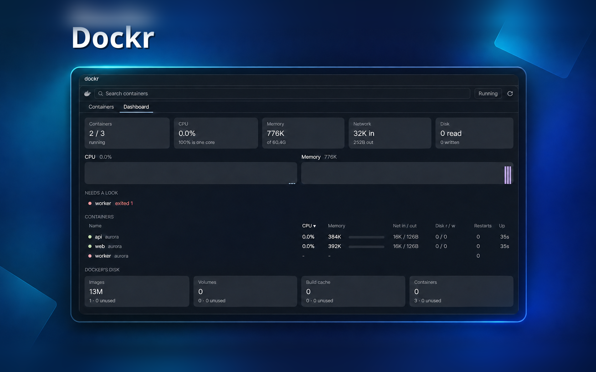

# Dockr

A dialog that lists Docker containers and sets which checkout each compose service runs from: the main checkout or a git worktree.



## Features

- **Container list.** Grouped by compose project, as Docker Desktop groups them, with live CPU and memory. Search by name, image, branch or published port, or show running containers only. This part needs no config.
- **Dashboard.** A second tab with CPU, memory, network and disk in all, their history, every container's use, what needs a look, and Docker's disk use.
- **Container actions.** Start, stop, restart, rebuild the image, open a terminal, copy the name, ID or image.
- **Container window.** Logs with search (plain or `/regex/`), follow and timestamps. Inspect. CPU, memory, network and disk Stats.
- **Group actions.** Start all, stop all, every container's logs in one stream, and Remove containers, which asks first.
- **Links.** A container's configured links or published ports open in the browser.
- **Checkout picker.** Move a service to one of its worktrees, or check a branch with no worktree out in the main checkout. Each choice says whether it costs a recreate or a rebuild, and Undo goes back. It offers to move the other services that have a worktree on the same branch.
- **Failures explained.** The row says why a container failed, with its last three log lines. Three exits in a minute show as a restart loop. A building or booting service shows the step it is on.
- **Diagnose.** For any container, failed or not: sends an agent Docker's report and the last 100 log lines, after showing you the exact text.
- **Drift and stale images.** Flags a service running a different checkout than the one set, and an image older than its dependency files.
- **Toasts.** A mark in your status bar counts running containers and posts a toast when a service starts, fails, turns unhealthy or keeps restarting.
- **Disk.** What the Stack and Docker hold, and a clean-up that never removes volumes.

## Needs

- Docker with compose, git, `sh` and `bash`. On Windows, point it at a WSL Machine.
- `ctrl-shift-d`. For toasts, one small block in your own layout.
- It runs docker and git, opens links in your browser, reads `~/.config/herdr-app/dockr.json` and writes `.dockr.env` beside the compose file. It runs `git switch` in a main checkout only when you pick a branch there. It never opens `.env` or reads the value of an environment variable.

## Install

Tell your agent:

```text
Read ~/.config/herdr-app/AGENTS.md, then add this mod: https://github.com/jbped/herdr-mods/tree/main/dockr
```

Or by hand:

1. Copy `mods/dockr/` to `~/.config/herdr-app/mods/`.
2. Merge `keys.json` into `~/.config/herdr-app/keys.json`.
3. For toasts, add this block to your own layout, beside the status bar:
   `{ "id": "dockr-chip", "type": "block", "size": { "px": 64 }, "content": { "mod": "dockr", "props": { "chip": true } } }`
4. Run `herdr-app check ~/.config/herdr-app/mods/dockr`, then press `ctrl-shift-d`.

## Use

`ctrl-shift-d` opens the dialog and closes it again. Hover or right-click a row for its actions, and click it to open the container. `?` lists every key for the selected row.

| Key | Action |
|---|---|
| `j` / `k` | move |
| `enter` | open the container, or fold a group |
| `s` / `x` / `r` | start / stop / restart |
| `t` / `c` / `b` | terminal / change checkout / rebuild image |
| `p` / `a` / `o` | live build output / diagnose with an agent / open its first link |
| `/` | search |
| `1` / `2` | containers / dashboard |
| `q`, `esc` | close |

The checkout picker needs `dockr.json`. The config file, every key and limits: [`mods/dockr/README.md`](mods/dockr/README.md).
