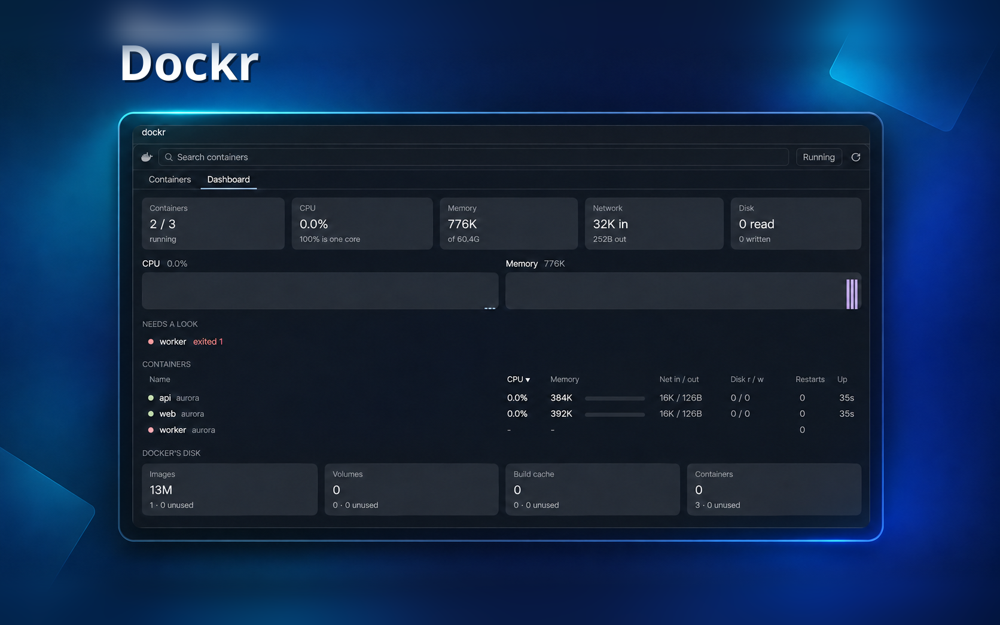

# Dockr

A side panel that lists every Docker container, grouped by compose project, with a status dot, live CPU and memory, and links to open in the browser. For a compose project listed in `dockr.json`, each service also shows the checkout it runs from, its repo's main checkout or a git worktree, and a picker moves it to another one. Rows explain failures in a sentence, and windows and dialogs show logs, inspect data, stats, disk use and a hand-off to an agent.



## What you see

The panel is one block in your own layout, 400px wide beside the work area. It has a 10px radius, a 1px border in `border`, a `background` fill and 12.5px text. Top to bottom:

- **Toolbar**, 40px, with a bottom border:
  - the Docker icon, 15px, in `muted`
  - a 26px search box on `surface` with the placeholder "Search containers"
  - a "Running" toggle, 24px high, with an `accent` border when on
  - a 22px refresh icon button
- **Warning line**, only when there is one: 11px text in `ansi3` on `raised`. It shows the first problem, or "3 problems." and the first one. The tooltip lists them all.
- **Note line**, only after an action: 11px text in `muted` with the outcome, such as "Switch gateway to feature/4821-cart-totals: recreating, no rebuild needed." After a switch it ends with a button "Undo: back to main".
- **The list**, the only part that scrolls. One group per compose project in `dockr.json`, then one per other compose project by name, then "Containers" for those in no project.
  - **Group header**, 34px:
    - a 12px fold arrow and the name in semibold
    - the state in 11px: "Running (4/6)", "Stopped (0/6)" or "Not created". It is `ansi2` when all run, `ansi3` when some run, `ansi1` when any container is bad, `dim` when none run.
    - the machine name and the group's totals in `dim`, such as "devbox · 31% · 1.2G"
    - a 12px turning ring in `working` while a group action runs
    - a filled "Start" or "Start all" button when something is not running, a stop icon when something runs, and a `⋯` icon. The "Containers" group has none of the three.
  - **Stack links**, a wrapping line of 18px chips for links that belong to no service.
  - **Container row**, two lines.
    - First line, 28px: the status mark, a 17px program icon in `muted`, the name, and the right side.
      - Status mark: an 8px dot in `ansi2` when running, an 8px dot in `ansi1` when unhealthy, exited with an error or in a restart loop, an 8px hollow ring in `dim` when stopped or not created, an 11px turning ring in `ansi3` while starting, and the same ring in `working` while Dockr works on it.
      - Right side, one of: a red chip "failed (exit 1)" for a failed build, the step in `working` ("checking", "building", "recreating", "starting", "waiting for healthy", "stopping", "restarting") with an output icon, the hover buttons, the state in 11px ("not created", "stopped", "exited 137", "unhealthy", "restart loop", "waiting for healthy", "restarting"), or CPU and memory such as "24% · 236M" in 10.5px `dim`. CPU at 90% or more is `ansi3`.
    - Second line, indented 49px:
      - for a configured service, a 19px checkout chip with a branch icon, the branch name and a chevron. It shows the first 8 characters of the commit for a detached checkout, "unknown checkout" when Dockr cannot tell, and "worktree is gone" in `ansi1` when the set path no longer exists. The chip is `ansi3` on drift.
      - for any other container, its image name in 10.5px `dim`
      - an `accent` chip "Switch to 4821" when the pane you are in is on a branch this service has a worktree for
      - up to 6 link chips, 19px, on `raised`, `accent` while the container runs. They are the configured links, or the published ports as ":3010" when there are none.
    - **Failure block** under a bad row: the cause in `ansi1` ("exited 137, out of memory", "health check: connection refused"), its last three log lines in the terminal font at 10.5px on `surface`, and the buttons Diagnose, Logs and Start or Restart.
    - **Notices** under a row in `ansi3`, with buttons:
      - "It runs from main, but Dockr has it set to feature/4821-cart-totals. A compose command run outside Dockr does this." with "Switch to 4821" and "Keep main"
      - "Its dependency files changed since the image was built." with "Rebuild"
      - in `ansi1`, "The worktree this service is set to no longer exists." with "Pick another"
- **With the keyboard**: the panel border turns `accent`, every header and row starts with a 20px letter badge on `raised`, the selected one is on `selected`, the second line indents 78px, and a legend line in 11px sits at the bottom with keys in `accent` and meanings in `dim`. `?` swaps the legend for a two-column list of every key on `raised`.
- **Empty states** in `dim`: "Reading Docker…", "No container matches.", "No containers yet. Start one with docker run or docker compose up and it shows here." With no `dockr.json`, a line under the list says how to list a compose project.

Overlays:

- **Container window**, 1100 by 680px, movable.
  - Title bar, 38px on `chrome`: the name, a 7px dot with "Running" or "Stopped", the tabs Logs, Inspect and Stats, a 220px search field, a match count with previous and next icons, the toggles Time and Follow, a copy icon, an icon that opens the raw tail in a terminal, then terminal, restart and stop icons or a start icon, and Close.
  - Logs: 17px rows in the terminal font at 11.5px. Error lines are `ansi1`, warning lines `ansi3`. Matching lines sit on `raised`, the current one on `selected`.
  - Inspect: name, image, command, state, created, started, the problem, health check output, "Runs from" and "Set to", ports, mounts, networks, the names of its environment variables and its labels.
  - Stats: a CPU chart in `ansi4` and a Memory chart in `ansi5`, each 90px high with one 8px bar per sample, then network in and out and disk read and write.
  - A legend line at the bottom.
- **Stack logs window**, same size, no tabs: every container's lines in time order, a line count, and one chip per service to hide or show it. Service labels are coloured `ansi4`, `ansi5`, `ansi6`, `ansi2`, `ansi3`, `ansi1` in turn.
- **Checkout picker**, a 520px popup 70px from the top: the service name and "runs from main", a filter field with an `accent` border, 28px rows with the branch and "current", "recreate · seconds" or "rebuild" (`ansi3`), a section "BRANCHES WITH NO WORKTREE", ticks "also move reports" and "Start if stopped", the buttons Rebuild and Switch, and a legend.
- **Action menu**, a 270px popup at the pointer with 26px items.
- **Diagnose dialog**, 720 by 560px: the cause, a warning to read the log lines first, the exact text the agent gets, one chip per installed agent, "new tab in <space>" or "new space", Cancel and "Send to <agent>".
- **Disk dialog**, 560 by 600px: the Stack's images and volumes, the engine's totals, three ticks and the buttons Refresh, Close and Clean up.
- **Terminal view**, a dialog 85% wide and 80% high: a 34px bar on `chrome` with a dot, the title, "keeps running when closed", and the buttons Stop, Keep as tab and Close, over the live terminal.
- **Confirm dialog**, 380px, Herdr's own: "Stop and remove the shop-local containers?" with "Volumes are kept, so the database stays."

## How it behaves

Dockr shows container states, not agent statuses. The only agent it touches is the one Diagnose starts.

Updating:

- The list changes when Docker reports a container created, started, stopped, removed, renamed or changing health. No timer runs.
- CPU and memory update about every two seconds while the panel shows, and stop while it is hidden.
- Showing the panel again reads `dockr.json`, the worktrees and Docker once. The refresh icon and `ctrl-r` do the same.
- Three exits inside one minute show as "restart loop".
- While the panel is hidden, a container of a configured Stack earns a toast: "gateway started", "gateway is unhealthy", "gateway exited 1" or "gateway keeps restarting". Clicking it shows the panel. Containers you acted on in the last 30 seconds earn none.
- A build that fails earns one toast, "Rebuild gateway failed". Clicking it opens the output.

Mouse:

- Click a row to open its container window. Click a group header to fold it. Folds and the Running toggle are remembered.
- Hover a row for Logs, Open terminal, Restart, Stop or Start, and `⋯`.
- Right-click a row, or click `⋯`, for the menu: Open, Open terminal, "Open localhost:3010 in browser" for up to 3 ports, Stop and Restart or Start, "Change checkout…", "Rebuild image", "Diagnose with an agent…", Copy name, Copy ID, Copy image.
- Right-click a group header, or click its `⋯`, for: "Logs of every container", Start all, Stop all, and for a configured Stack "Disk and clean-up…" and "Remove containers…". Other projects end with the note "Not in dockr.json: checkouts cannot be switched".
- Click a link chip to open it in the system browser.
- Click the checkout chip to open the picker.
- Search matches every word against the name, image, branch and published ports.

Panel keys, after `ctrl-shift-d`:

| Key | Action |
|---|---|
| `ctrl-shift-d` | show the panel and take the keyboard. Pressed again, hand it back and hide the panel |
| `j` / `k`, arrows, `ctrl-n` / `ctrl-p` | move |
| a row's letter | jump to it |
| `g` / `G` | first / last |
| `ctrl-d` / `ctrl-u` | half a page down / up |
| `ctrl-r` | read Docker, the worktrees and `dockr.json` again |
| `enter` | open the container, or fold the group |
| `s` / `x` / `r` | start / stop / restart |
| `t` | terminal in the container |
| `c` / `b` | change checkout / rebuild image, on a configured service |
| `a` | diagnose with an agent |
| `o` | open its first link or port |
| `y` | copy the container name |
| `S` / `X` | start all / stop all in the group |
| `D` | remove the group's containers, after a confirm |
| `h` / `l` | fold / unfold the group |
| `m` | the menu (`j`/`k`, `enter`, `esc`) |
| `/` | search. `enter` or `esc` returns to the list |
| `?` | list every key for the selected item |
| `q`, `esc` | hand the keyboard back to the pane on the left |

A key that does nothing on the selected item is left out of the legend. A press outside the panel also ends key mode.

Container window:

- Logs start with the last 300 lines and follow new ones. The window keeps the last 5,000.
- Search takes plain text or `/regex/`, both ignoring case. Scrolling up turns Follow off.
- Keys: `h`/`l` tabs, `j`/`k` line, `g`/`G` top and end, `/` search, `n`/`N`, `ctrl-n`/`ctrl-p` or `F3` match, `a` investigate with an agent, `f` follow, `t` timestamps, `y` copy the lines shown, `s`/`x`/`r` start, stop, restart, `T` terminal, `q` or `esc` close.
- Stats samples only while its tab shows and keeps the last 90 samples.
- When the container stops, the dot says "Stopped" and the window waits for it to start again.

Checkout picker:

- Typing filters by branch or path. Arrows or `ctrl-j`/`ctrl-k` move, `enter` switches, `ctrl-b` rebuilds, `ctrl-s` toggles "Start if stopped", `esc` closes.
- Each checkout says what it costs. "recreate" brings the container up again. "rebuild" builds the image first.
- When other services have a worktree on the picked branch, "also move <service>" is ticked for each.
- A switch of a running service starts at once. A stopped one stays stopped unless "Start if stopped" is ticked, and the note says "set. Nothing was running, so nothing was started."
- Undo puts the old checkouts back.

Actions:

- Start, stop and restart run to their end while the row shows the word.
- Switch, rebuild, Start all on a Stack and Remove containers run in a background terminal. The row shows the step. Click the output icon to watch.
- Closing the terminal view leaves the terminal running. Stop ends it. Keep as tab gives it a tab.
- A failed one stays as a red chip until you open it and press Dismiss.
- Diagnose sends nothing until you press Send or `enter`. It starts the picked agent in a new tab of the space on that checkout or branch, else in a new space.
- Clean up first shows what it will remove, then asks again with "Remove them". It never removes a volume.

## Built from

No layout ships with it. The person adds one block to their own layout and keeps the id `dockr`:

```json
{ "id": "dockr", "type": "block", "content": { "mod": "dockr" }, "size": { "px": 400 }, "min": 300, "hidden": true }
```

`keys.json`: `global` binds `ctrl-shift-d` to `mod.open:dockr`. `mod:dockr` binds `ctrl-shift-d` to `dockr.hide`.

Config, `~/.config/herdr-app/dockr.json`. With no file, Dockr lists every container and manages none.

```json
{ "stacks": [ {
  "name": "shop-local",
  "machine": "devbox",
  "compose": "/home/sam/shop/deploy/docker-compose.local.yml",
  "services": {
    "gateway": { "var": "GATEWAY_PATH", "repo": "git.example.test/shop/gateway", "main": "/home/sam/shop/gateway" },
    "reports": { "var": "REPORTS_PATH", "main": "/home/sam/shop/reports", "manifests": ["Reports.Api/Reports.Api.csproj"] }
  },
  "urls": {
    "https://shop.example.test": { "label": "Shop", "service": "web" },
    "http://localhost:3010/health": "Gateway health"
  }
} ] }
```

- `name` is the compose project name. `machine` is a Herdr machine, left out for this computer. `compose` is an absolute path on that machine.
- `services.<name>.var` is the compose variable that holds the service's checkout path. `main` is the main checkout. Without `main`, Dockr looks `repo` up in `wranglr.json`: `workspaces[].on.<machine>.paths.<repo>`, then `repos.<repo>.on.<machine>.path`.
- `manifests` are the dependency files compared to decide on a rebuild, relative paths with no `..`. Default: `package.json` and `package-lock.json`.
- `urls` maps an http or https URL to a label, or to `{ label, service }`.

Files in `mods/dockr/`:

- `mod.json`: `"place": "none"`, `"title": "Dockr"`, `"focusable": true`, `"overlay": { "kind": "popup", "at": "top", "offset": 0, "width": 1, "height": 1, "frame": "none" }`, and a `palette` list: "Dockr: Toggle" (`layout.toggle {id: "dockr"}`), "Dockr: Keys" (`mod.open {name: "dockr"}`), "Dockr: Reload" (`dockr.reload`), "Dockr: Disk" (`dockr.disk`), "Dockr: Stack logs" (`dockr.logs`).
- `main.js`: the default `View`. `props()` picks the role:
  - none: the panel
  - `overlay` only (opened by `mod.open`): shows the `dockr` node if hidden, sets the shared request `{kind: "keys"}`, closes itself and draws nothing
  - `picker`: the checkout picker
  - `peek {address, title, stop}`: the 34px bar over a terminal
  - `diagnose`, `logs`, `menu`, `disk`: handed to the four files below
  - It also holds the shared `button`, `iconButton` and `check` controls the other files draw with.
- `model.js`: every decision, with no Herdr or Docker calls. Config parsing, path comparison, which checkout a container runs from, drift, what a switch changes, rebuild or recreate, toasts, status and cause text, restart loops, the agent brief, log, stats and disk parsing, grouping, search, and the key map.
- `docker.js`: every `exec`, `hc` and `readTextFile` call.
- `store.js`: the `Store` class. It holds the Stacks, containers, env state and checkouts, and prepares each action's script.
- `logs.js`: the container window and the Stack logs window (`props().logs` with `title`, `machine`, `sources`, `terminal`, and `info` for one container).
- `diagnose.js`: the Diagnose dialog (`props().diagnose` with `service`, `machine`, `folder`, `branch`, `why`, `brief`).
- `disk.js`: the Disk dialog (`props().disk` with `stack`, `machine`).
- `menu.js`: the action menu (`props().menu` with `key`, `items`).
- `kit/theme.js`, `kit/list.js`, `kit/letters.js`, `kit/legend.js`, `kit/README.md`, `kit/LICENSE`: copied unchanged from the `kit/` folder of CodeyPacker/herdr-mods at commit 90949f0, MIT. Dockr uses `legend` from `legend.js` and `assignLetters`, `letterBadge` and `navigateByLetter` from `letters.js`. `theme.js` gives them `SIZE` (`small` is 11) and `list.js` is imported by `letters.js`.
- `README.md`: the reference for the person.
- `icons/`: 21 stroke icons, 24px viewBox, stroke width 2, `currentColor`: `branch`, `check`, `chevron`, `copy`, `diagnose`, `disk`, `down`, `logs`, `more`, `output`, `play`, `power`, `rebuild`, `restart`, `right`, `search`, `shell`, `spinner`, `stop`, `undo`, `up`. `spinner.svg` is an open arc turned with `.spin(900)`.

Art from Herdr: the program icons in the home folder's `icons/`, picked by image and command: `nginx`, `psql`, `redis-cli`, `mongosh`, `mysql`, `dotnet`, `vite`, `node`, `python`, else `docker`. Colors are theme tokens only. Log lines and the brief use `settings().font_family`, else "JetBrains Mono".

Shipped mod used: `confirm`, opened with `{title, detail, command: {name: "dockr.downConfirmed", args: {}}}`.

Herdr functions:

- Live data: `layout`, `spaces`, `panes`, `focused`, `terminals`, `theme`, `settings`, `window`, `props`
- State: `shared` and `setShared` with the one key `dockr.request`, `nextCommand`, and `localStorage` keys `built`, `folded2`, `running`, `start`
- Overlays: `openOverlay` (kinds `popup`, `dialog`, `window`, and a dialog with a `layout` holding a mod block and a `{terminal}` block), `closeOverlay`, `notify` with `action`
- Machine: `exec` with `on` and `timeout`, `hc`, `readTextFile` with `on`, `appHome`, `knownAgents` with `on`
- `run`
- From `gpui-base`: `InputState`, `Input`, `ScrollHandle`, `Scrollbar`, `v_virtual_list`, `VirtualListScrollHandle`. The clipboard is `cx.write_to_clipboard`.

Commands:

- Through `run`: `layout.show`, `layout.hide`, `pane.go`, `tab.new`, `space.new`, `terminal.keep`
- As toast actions: `layout.show`, `terminal.peek`
- From `mod.json` and `keys.json`: `layout.toggle`, `mod.open`
- Its own, read from `nextCommand()`: `reload`, `focus` (sent by Herdr), `keys`, `hide`, `disk`, `logs`, `downConfirmed`

Programs, all on the Stack's machine unless noted:

- `docker`: `ps -a --no-trunc`, `inspect`, `logs`, `events`, `stats`, `system df`, `image ls`, `volume ls`, `start`, `stop`, `restart`, `exec -it`, `image rm`, `image prune -f`, `builder prune -f`, and `run --rm --entrypoint sh <image>` to hash the manifests inside an image
- `docker compose -f <compose> [--env-file <dir>/.env] [--env-file <dir>/.dockr.env]` with `build`, `up -d`, `up -d --build`, `start`, `stop`, `restart`, `down`, `logs -f --tail 200`. Each env file is passed only when it exists.
- `git -C <main> worktree list --porcelain` and `git -C <main> branch --sort=-committerdate`
- `sh`, and `bash` for the waits (`coproc`, `read -t`, `EPOCHREALTIME`)
- `cat`, `sha256sum`, `cut`, `mv`, `printf`, `kill`
- `hc run --bg --no-parent --outlive-parent --label dockr.<key>=<value> --cwd <dir> [--on <machine>] --json -- sh -c <script>`, `hc kill <address>`, `hc --version`, and inside a script `hc label "$HC_TERMINAL_ID" dockr.failed=<code>`
- On this computer, for links: `rundll32 url.dll,FileProtocolHandler <url>` on Windows, `open` on macOS, `xdg-open` elsewhere

Terminal labels: `dockr.stack`, `dockr.kind` (`op`, `logs`, `shell`), `dockr.verb` (`switch`, `up`, `down`), `dockr.title`, `dockr.services`, `dockr.build`, `dockr.service`, `dockr.at`, `dockr.failed`. The panel reads progress back from these through `terminals()`.

Files outside its own folder:

- Reads `~/.config/herdr-app/dockr.json` and `~/.config/herdr-app/wranglr.json`.
- Reads this computer's hosts file, `/etc/hosts` or `C:/Windows/System32/drivers/etc/hosts`. Names mapped to `127.0.0.1` or `::1` become `https://<name>` links on the running service that publishes port 443.
- Reads and writes `.dockr.env` beside the compose file. It writes to `.dockr.env.dockr-<pid>` and moves that over it. Lines hold `VAR=<worktree path>`. A service on its main checkout has no line.
- Tests whether `.env` beside the compose file exists. It never opens it.
- Hashes the manifest files in each checkout and inside the image.
- No network calls of its own.

## Watch out

- A hidden panel hears no `dockr.*` commands, so the key cannot be a mod command. `mod.open:dockr` opens a second copy as a 1 by 1px frameless popup, which is why `mod.json` has an `overlay`. That copy shows the panel and passes the key on through `shared`.
- Only Herdr can move the keyboard off a terminal. The panel calls `pane.go {direction: "right"}` up to 6 times, awaiting `hc --version` between steps, until its `focus` command arrives. It leaves with `pane.go {direction: "left"}`. A panel on the left needs both directions swapped in `main.js`.
- The focus handle still answers `is_focused()` in the render after the keyboard left. The panel keeps its own `gone` flag, set on leave and on `on_mouse_down_out`.
- If the `mod:dockr` key section is missing, the popup takes the keyboard before the key arrives. The panel then hides when it held the keyboard less than 1500 ms ago.
- `exec` stops after 30 s by default. The waits pass their own `timeout`: 600000 ms around a 570 s `docker events` wait, 90000 ms around a 60 s log wait, 60000 ms for a stats sample, 120000 ms for disk, 180000 ms for start, stop and restart.
- Windows itself is not supported as a machine, because the waits need `sh` and `bash`. Point `machine` at a WSL machine. Paths written as `C:\dev\shop`, `/mnt/c/dev/shop` and `/run/desktop/mnt/host/c/dev/shop` compare as equal, in lower case.
- Docker Desktop hides a WSL bind mount behind another path. The real one is in the label `desktop.docker.io/binds/<n>/Source`, which only `docker ps --format '{{json .}}'` prints.
- The `docker inspect` template cuts each environment entry to its name inside Docker. Keep it that way, so no value reaches the mod.
- `docker inspect` exits 1 when a container was removed between the two calls and still prints the rest. Use what it printed.
- One stats sample is the text between two `ESC[H` codes in the `docker stats` stream.
- A compose command run by hand does not load `.dockr.env`, so it brings services up from the main checkouts and Dockr shows drift.
- The first write of `.dockr.env` also records every other service already running from a worktree. Before the file exists, what runs counts as what is set, so a first look never shows drift.
- Docker does not record which folder an image was built from. A service with no bind mount shows "unknown checkout" until Dockr builds it. That record is in `localStorage` (`built`), per mod copy. Such a service always costs "rebuild".
- Rebuild detection compares only the manifests. The image needs `sh`, `cat`, `sha256sum` and `cut`, else the cost reads "rebuild". The stale notice covers bind-mounted services only.
- The first look earns no toasts. The copy starts the first time the panel shows, so no toast arrives before that.
- Nothing draws while the panel is hidden. The failed-build toast is posted from `render`, so it appears at the next draw.
- `dockr.reload`, `dockr.disk`, `dockr.logs` and `dockr.downConfirmed` reach a shown panel only. `dockr.disk` and `dockr.logs` act on the first configured Stack, else the first compose project. `dockr.disk` does nothing without a configured Stack.
- A failed script waits for Enter, so its terminal stays live and the red chip stays until Dismiss.
- Limits: 5,000 log lines, 300 on open, a 2,000 character line width, 6 link chips per row, 3 ports in the menu, 30 branches with no worktree, 60 stats samples per container in the panel, 100 log lines of at most 400 characters in the brief, 20 lines read for a failure and 3 shown.
- Controls that do nothing: the "Previous match (Shift+F3)" tooltip names a key that goes to the next match, and only `N` goes back. The `keys` command is handled but nothing sends it. The icons `diagnose`, `disk`, `power`, `rebuild` and `undo` are not drawn. `kit/list.js` and `readLetterConfig` in `kit/letters.js` are never called, so `hints.json` is not read.
- The names `dockr` are fixed in code: icon paths `mods/dockr/icons/`, the overlay mod, the layout node id and the shared key. Renaming the mod means changing all four.
- Keep `.dockr.env` out of git.

## Done when

- `herdr-app check ~/.config/herdr-app/mods/dockr` passes.
- With the block in the layout and no `dockr.json`, showing the panel lists every container grouped by compose project, with "Running (n/m)" on each header, and CPU and memory appear on running rows within a few seconds.
- `ctrl-shift-d` shows the panel with an `accent` border, letter badges and the legend. `q` hands the keyboard back. `ctrl-shift-d` again hides the panel.
- `x` on a running row shows "stopping", then a hollow ring and "stopped". `s` starts it again.
- Stopping a container from a shell outside Herdr changes its row without a reload.
- Clicking a row opens the window with its last log lines. Typing `/err.*/` shows a match count, and the Stats tab draws bars after about two seconds.
- With a Stack in `dockr.json`, clicking a service's checkout chip opens the picker, and each checkout shows "current", "recreate · seconds" or "rebuild".
- Switching a service to a worktree writes its `VAR=<path>` line to `.dockr.env`, the row shows "recreating" or "building", then the chip names the new branch and "Undo: back to main" appears.
- Running `docker compose up -d` by hand for that bind-mounted service shows the drift notice with its two buttons.
- A container that exits with an error shows the cause, its last three log lines and Diagnose. The dialog shows the brief, which holds no environment values, and nothing starts before Send.
- "Remove containers…" asks first, and the volumes are still there afterwards.
