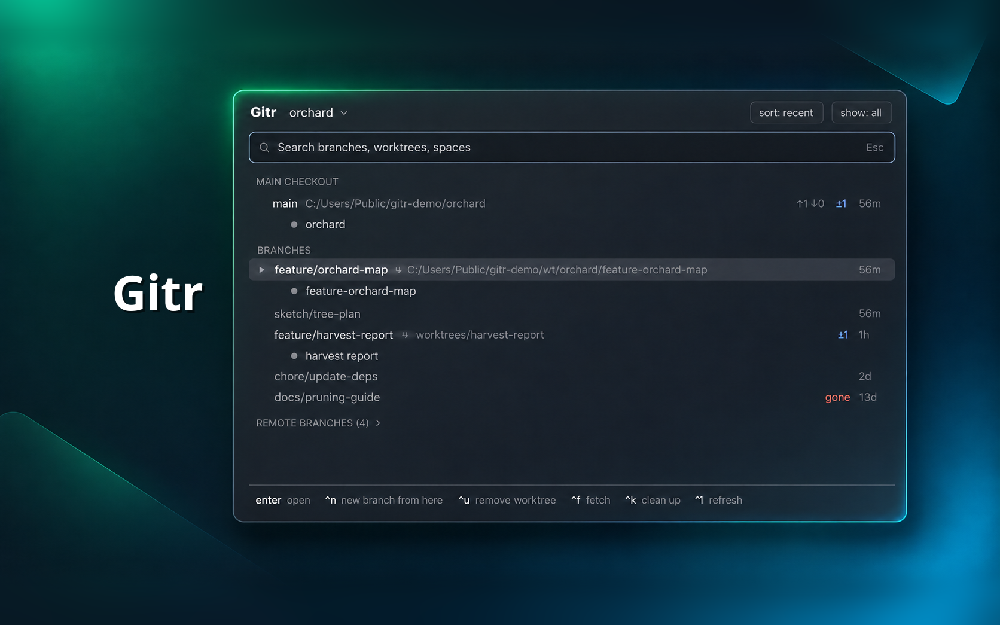

# Gitr

A popup at the top of the window that shows one git Repo on one Machine: the Main checkout first, then every local Branch on one row each with its Worktree, its state and the spaces working in it, then the remote branches no local Branch has. From the list you go to a space, start a space, give a Branch a Worktree, check a Branch out, make, delete or rename a Branch, remove a Worktree, fetch and clean up. Questions show inside the same popup.

## What you see

A popup 860px wide on `popover`, 40px below the top of the window, with 12px padding and 8px between its parts. Text is 13px in `foreground` unless said otherwise. Top to bottom:

- **Title row**, 26px. "Gitr" in 14px semibold. The Repo name with a 12px `chevron-down` in `dim`, clickable. The Machine name ("this computer" for this one) in `muted` with a chevron, only when the Repo is on more than one Machine. At the right two chips, 11px `muted` text, 1px `border` outline, radius 5: `sort: recent` or `sort: A to Z`, and `show: all`, `show: with worktree` or `show: checked out nowhere`.
- **Search bar**, 36px, radius 8, 1px `accent` border on `background`: a 14px search icon in `dim`, the field (12.8px, placeholder "Search branches, worktrees, spaces"), and "Esc" in 11px `dim`.
- **Error line**, only after a failed read with a last known list: git's message in 12px `dim`.
- **List**, 440px high, scrolling. Section titles are 11px `dim` capitals, 26px high: `MAIN CHECKOUT`, `BRANCHES`, `REMOTE BRANCHES (n)` with a chevron. Rows are 28px, radius 6, 10px side padding:
  - a 10px column with `▸` in `accent` on the selected row, which has a `selected` background. Other rows show `hover` under the pointer.
  - the name: `muted`, `foreground` when selected, `dim` for a Branch checked out nowhere, a remote branch, or every row of an unreachable Machine. A Create row's name is `accent`.
  - for a Branch with a Worktree, `⑂` and the Worktree's directory in 12px `dim`. For the Main checkout, its directory.
  - a spinner (`mods/workspace-chrome/spinner.svg`, 12px, `working`, `spin(900)`) while the row's action runs.
  - at the right, 12px, 10px apart: `↑n ↓n` in `dim`, `±n` in `done`, `gone` or `prunable` in `blocked`, and the age in a 34px `dim` column.
  - space rows are indented 12px more: a 7px round dot in the status color (`working`, `blocked`, `done`, `idle`, else `unknown`), the space name, and the status word at the right in its color.
- With nothing to show, the list holds one `dim` line ("No branches", or `Nothing matches "<text>"`). Before the first read it shows a spinner and "Reading...". A failed first read shows git's message in `muted`.
- **Footer**, under a 1px `border` line, 11px: `key label` pairs (key in semibold `accent`, `^o` for `ctrl-o`, label in `dim`), about 14px apart, each a clickable pill with `hover`.

A question replaces everything under the title row (the chips hide) with a 520px panel: a 15px semibold title, its body, Cancel (`raised`, `input` outline) and the yes button (`solid`, or `blocked` when it can lose work), both 32px with radius 8, and a footer of its keys.

- Confirm: each line in `muted`, then each check as a 14px tick box (`accent` when ticked) and its label.
- Input: a 36px field with `accent` border, the error under it in `blocked`. The yes button is "Rename" for a rename, else "Create".
- Checklist: one row per item, a tick box, the label and a 12px `dim` detail.
- Repo and Machine pickers: a filter field and one 30px row per Repo (name and identity) or Machine (name and Main checkout path).

## How it behaves

- `alt-shift-g` runs `mod.open {"name": "gitr"}` and opens it on the focused space's Repo, on that space's Machine. Running it again closes it.
- Typing filters by Branch name, Worktree directory and space name. A space that matches keeps its Branch, a Branch that matches keeps its spaces. A search unfolds remote branches. Typing a valid name no Branch has adds a `Create "<name>"` row.
- `up`, `down`, `pageup`, `pagedown` (10 rows), `home`, `end` move the selection. The selection keeps its row across refreshes and moves to the nearest row when its row goes.
- `enter` runs the row's default: a space row goes to that space and closes Gitr. The Main checkout and a Branch with a Worktree go to their first space, else start one there. A Branch checked out nowhere, a remote branch and a Create row get a Worktree and a space, or a checkout in the Main checkout, as the setting says.
- `ctrl-o` checkout, `ctrl-w` Worktree, `ctrl-n` new Branch, `ctrl-d` delete, `f2` rename, `ctrl-u` remove Worktree, `ctrl-f` fetch, `ctrl-r` refresh, `ctrl-k` clean up, `ctrl-s` sort, `ctrl-t` filter, `ctrl-g` fold remote branches, `ctrl-p` switch Repo, `ctrl-e` switch Machine.
- `escape` closes a question, else clears the search, else closes Gitr.
- A click selects a row. A click on the selected row or a double click runs Enter. Chips, the Repo and Machine names, the remote section title and footer items run their action on click.
- Agent status shows only on space rows: the dot and the word take the `working`, `blocked`, `done` or `idle` color. Nothing animates except the spinners.
- Gitr closes after an action that takes you to a space and stays open after any other, reading the Repo again. A failed action shows git's message as an error toast.

## Built from

- `mods/gitr/mod.json`: `{ "place": "none", "title": "Gitr", "overlay": { "kind": "popup", "at": "top", "offset": 40, "width": 860, "height": 0.75 }, "palette": [{ "title": "Gitr: Open", "command": "mod.open", "args": { "name": "gitr" }, "about": "..." }] }`.
- `keys.json` in the share: `{ "global": { "alt-shift-g": "mod.open:gitr" } }`.
- `main.js`: one `View`. Props: `overlay`, and optionally `repo` (an identity) and `machine`. It builds a world from `spaces()`, `panes()`, the git state and its own search, sort, filter and fold, draws `arrange(world)`, sends every key and click to `act(world, action)`, shows the question `act` returns, and runs the effects with `runEffects`.
- `model.js` (pure rules), `gitread.js` (`git worktree list --porcelain`, `git for-each-ref`, `git --no-optional-locks status --porcelain`), `effects.js` (runs effects, the stash procedure), `source.js` (Wranglr or standalone), `repos.js` (Repo identity and git on a Machine, WSL paths from Windows), `store.js` (settings and state).
- Herdr functions: `checking`, `props`, `closeOverlay`, `notify`, `theme`, `spaces`, `panes`, `focused`, `layout`, `shared`, `setShared`, `run`, `openOverlay`, `exec`, `window`, `appHome`, `readTextFile`, `writeTextFile`. gpui-base: `InputState`, `Input`, `ScrollHandle`. `cx.bind_keys`, `key_context`, `on_action`.
- Commands: `space.select`, `space.close {id, confirmed: true}`, `space.new {folder, machine, argv?}`. The shipped `worktree` mod opened as a 440 by 260 dialog with `{ folder, machine, branch, argv? }`. With Wranglr: `wranglr.action` actions `start` and `plus`.
- Programs: `git` on the Repo's Machine (`wsl.exe` for a WSL path from Windows). Network: `git fetch` only.
- Files: reads `gitr.json`, writes `data/gitr/state.json`, both under `appHome()`.
- Art: `search.svg`, `chevron-down.svg`, `chevron-right.svg`, `check.svg` and `spinner.svg` from the shipped `workspace-chrome` mod. Theme tokens only.

## Watch out

- The popup sizes to its content, so a list with `flex_1` collapses to nothing. The list has a fixed 440px height.
- Herdr closes a popup on Escape before the mod sees the key, and the search field keeps `home` and `end`. Gitr gives its root `key_context("Gitr")` and binds `escape` (in `Gitr` and `Gitr > Input`) and `home` and `end` (in `Gitr > Input`) to its own actions with `cx.bind_keys`, once per module load.
- The search field takes `ctrl-x` as cut, so remove is `ctrl-u`. Other `ctrl` letters reach the root's `on_key_down`. Match `ctrl` keys by `keystroke` and plain keys by `key`, so a held shift does not hide `down` or `enter`.
- `init` returns under `checking()` before any `exec`.
- The `close` effect closes the overlay, so redraws after it are wrapped in `try`.
- A rename that only changes letter case fails on Windows, where git's refs are not case sensitive. Gitr shows git's error.
- Status needs agents that report it. A plain shell has none, so its dot uses `unknown`.

## Done when

- `herdr-app check ~/.config/herdr-app/mods/gitr` passes.
- `mod.open {"name": "gitr"}` in a space inside a Repo shows `MAIN CHECKOUT` with that Repo's Branch, and the space under it.
- A Worktree's Branch shows `⑂` and its directory, and a space in the Worktree is under it.
- Typing filters the rows, and a new name adds a Create row. `escape` clears the search, and a second `escape` closes Gitr.
- `ctrl-s` and `ctrl-t` change the chips and the rows. `ctrl-g` unfolds the remote branches.
- `ctrl-u` on a Branch with a Worktree asks, and yes removes the Worktree and closes its spaces.
- `ctrl-o` with a changed Main checkout offers the stash, and yes leaves the Main checkout on the Branch with the changes reapplied and no extra stash entry.
- `ctrl-k` lists the Branches whose upstream is gone, and yes deletes the ticked ones.
- `ctrl-w` on a Branch checked out nowhere opens Herdr's worktree dialog, which makes the checkout and its space.
