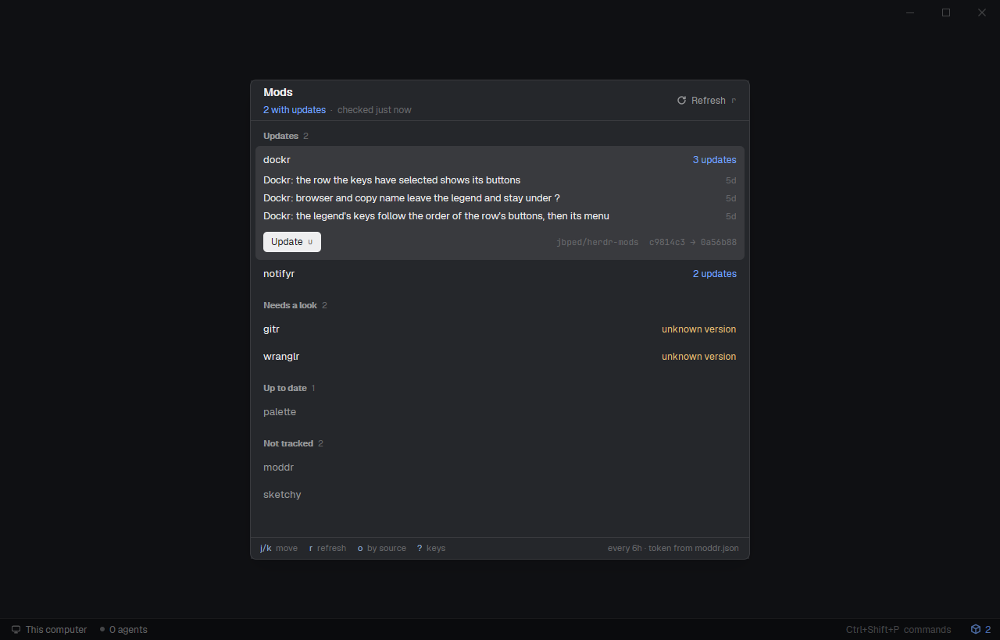

# Moddr

Finds where each of your mods came from on GitHub, tells you when one has an update, and installs it.



## Features

- **Finds sources by itself.** Moddr looks for each mod in the repos its README links, in repos where your other mods were found, and in GitHub's `herdr-mod` repos that mention it. A mod whose files match a version there is tracked without asking.
- **Checks on its own.** Every 6 hours by default, from the status-bar badge or when you open the list. `ctrl-r` checks now.
- **Updates in place.** `u` installs the newest version: only the changed files, one at a time, after a backup. Restore puts the backup back.
- **Talk drift through with an agent.** `a` opens a new space where your agent compares your copy with the source, explains what changed on each side and helps you merge.
- **A badge in your status bar.** It shows how many mods have updates and opens the list when clicked.
- **A toast for new updates.** Each new update is announced once, with the names of the mods.
- **What changed.** A mod with updates lists the new commits that touched its folder, with their messages and ages.
- **Installed version found from the files.** Moddr matches your files to an upstream commit, so it knows what you installed without being told.
- **Local edits.** A mod you changed by hand shows "edited here" and the files that differ. An update over them asks first.
- **Sources by hand.** Paste a GitHub folder link for a mod it could not find: the mod's folder, or the share folder that holds it.
- **Signs in with gh.** When the GitHub CLI is signed in, Moddr uses its token: 5,000 requests an hour instead of 60, and private repos.

## Needs

- Herdr and git. Sources are GitHub repos. The GitHub CLI (`gh`) is optional.
- It runs `git hash-object` on the files in your mods folder, and `gh auth token` when it starts. The token stays in memory and is sent only to api.github.com.
- It reads `installed.json` and each mod's `README.md`, and writes `moddr.json` in the Herdr config folder.
- An update or restore rewrites that mod's folder. It downloads the source with `git clone`, and keeps the last 3 backups and the drift folders in `data/moddr/`.
- `a` starts your most-used installed agent (from Herdr's agent list) in a new space.
- It calls the GitHub API every 6 hours while the badge or the list is shown. Signed out, a first run over a dozen mods takes about 50 of the 60 requests GitHub allows an hour. Later runs take about 2 per mod.

## Install

Tell your agent:

```text
Read ~/.config/herdr-app/AGENTS.md, then add this mod: https://github.com/jbped/herdr-mods/tree/main/moddr
```

Or by hand:

1. Copy `mods/moddr/` to `~/.config/herdr-app/mods/`.
2. Merge `keys.json` into `~/.config/herdr-app/keys.json`. It binds `ctrl-shift-u`.
3. For the badge, add a block to your own layout's status row (Herdr's shipped layouts are read-only, so clone one first): `{ "id": "moddr-badge", "type": "block", "size": { "px": 48 }, "content": { "mod": "moddr", "props": { "badge": true } } }`.
4. Run `herdr-app check ~/.config/herdr-app/mods/moddr`.

## Use

Click the badge, press the key or pick "Moddr: Open" in the palette. The first time, Moddr looks for every mod's source and checks it. Select a mod to see its commits and buttons.

| Key | Action |
|---|---|
| `ctrl-shift-u` | open the list, again closes it |
| `j` / `k` | down / up |
| `ctrl-r` | look for new sources and check every tracked mod |
| `o` | open the selected mod's source on GitHub |
| `]` / `[` | group the list by source repo or by state |
| `u` | update the selected mod, after a confirmation |
| `U` | update every mod with updates, after one confirmation. Mods changed here are left out |
| `a` | discuss its drift with an agent in a new space |
| `z` | restore the last backup |
| `s` | set or change the source |
| `x` | stop tracking, and stop looking for its source |
| `q` or `escape` | close |

Every key, every state, how sources, versions and updates work, the drift space, the settings in `moddr.json`, signing in and the limits: [`mods/moddr/README.md`](mods/moddr/README.md).
