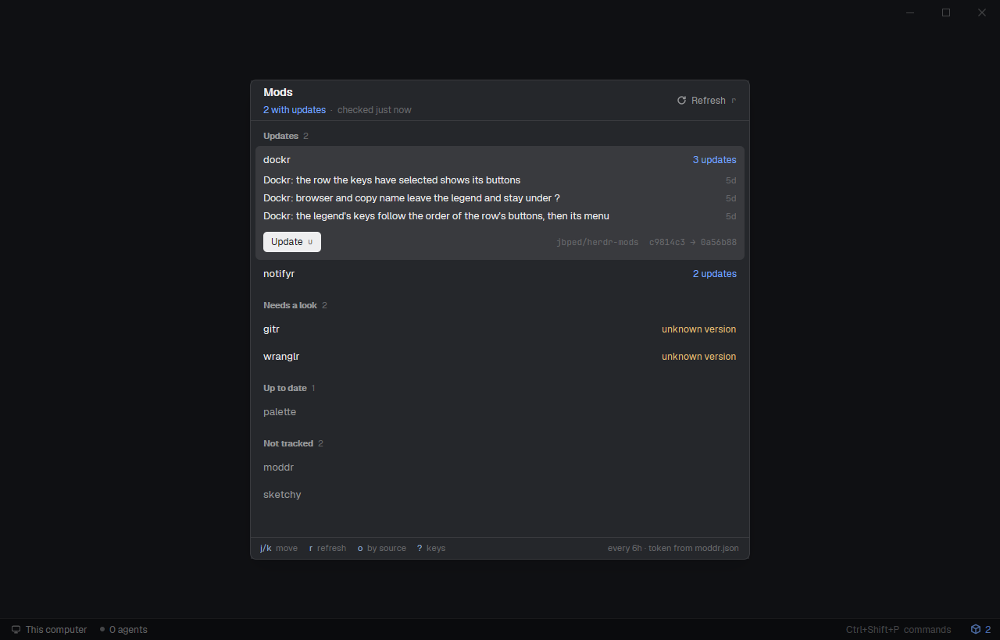

# Moddr

A dialog and a status-bar badge for the person's own mods. Moddr finds the GitHub folder each mod was installed from, works out the installed version by hashing the local files and matching them to an upstream commit, and checks every few hours for new commits. New updates are announced once with a toast, the badge counts them, and the list shows each mod's new commit messages and local edits. It installs an update file by file after a backup, restores backups, and opens a space where the person's agent talks a mod's drift through.

## What you see

- **Badge**: a block the person places, 48px wide in a 28px status row, on `chrome` with a 1px top border in `border`. A 14px box icon (`box.svg`, tinted) in `muted`. With updates, the icon and an 11.8px count beside it are `done`. After a refresh GitHub cut short, the icon is `working`. While a refresh runs, a braille spinner in `accent` replaces the icon. Tooltip: "Updates: a, b", the error, "N tracked mods, none with updates. Checked 5m", or "Moddr has not checked yet", then ". Click to open Moddr (ctrl-shift-g)".
- **List**: a dialog 640px wide and 75% of the window high, on `popover`.
  - Header, 52px with a bottom border: "Mods" in 14px semibold over an 11.5px line: "2 with updates" in `done`, a `dim` "·", then "checked 5m ago" (or "just now", "not checked yet") in `dim`. While a refresh runs the line is "Finding sources…" or "Checking…" in `accent`. At the right a quiet "Refresh" in 12px `muted` with `refresh.svg` and a `dim` monospace "r", `foreground` on hover; while busy a braille spinner in `accent`, inert.
  - Banners under the header, 12px in, on `raised` with radius 6: a 6px dot (`blocked` for a file error, `working` for the last refresh's error) and the message in 11.5px `muted`.
  - The source editor, when open, is a card in the same place: "Source of <name>", a 28px input with a 1px `input` border on `background`, and one 11.5px line: the help, "Looking it up on GitHub…" in `accent`, or the error in `blocked`.
  - Sections, the only part that scrolls, in this order and only when not empty: "Updates", "Needs a look" (edited here, unknown version, error, not checked), "Up to date", "Not tracked". Each heading is 11px semibold `muted` with its count in `dim`, 16px in. After `o`, one section per source repo ("owner/repo", A to Z), then "No source"; every row shows its status and the open row drops the repo. The choice is kept in `localStorage` (`moddr.sort`).
  - A row, 6px in from the sides with radius 6 and 10px/7px padding: the name in 13px and, at the right in 12px, the status: "N updates" `done`, "edited here" and "unknown version" `working`, "error" `blocked`, "checking…" `accent`, "not checked" `muted`. Up to date and not tracked rows have no status and a `muted` name: their section says it. Hover `hover`.
  - The selected row is on `selected` and opens below the name: a one-line reason in 12px `muted` only for unknown version, not checked and not tracked; the error in `blocked`; the new commits (the message in 12.5px `foreground` truncated, the age at the right in `dim`); "You changed a.js, b.js" in 12px `working` (4 names, then "and N more"); then one line of at most two 26px buttons and, at the right in 11px `dim` monospace, "owner/repo  c9814c3 → 0a56b88" (or the installed sha and its age).
  - Buttons: radius 5, each with its key in `dim` monospace. The first is solid (`solid` on `solid_foreground`), the second has a 1px `border` outline. Updates: Update. Edited or unknown: Discuss drift, then Mark installed (unknown) or Update (updates with edits). Not tracked: Set source. Error or not checked: Check. Up to date: none. Every other action is a key, listed under `?`.
  - A confirmation replaces the buttons: one line, "Update dockr? A backup is kept." (or "Replace your changes to 2 files? A backup is kept." in `working`, or "Put back the backup from Nov 23, 19:19? A backup is kept."), a solid "Update y" or "Restore y" and an outlined "Cancel n". Progress replaces them too: a spinner and "Updating · Writing icons/info.svg (3 of 6)" in `accent`.
  - Footer, the other mods' legend: 28px with a top border, 11px, 12px in, hints 14px apart, each key in `accent` and its word in `dim`: "j/k move", "r refresh", "o by source" (or "by state"), "? keys"; at the right "every 6h · signed in with gh" in `dim`. `?` hides the hints and shows every key above the footer on `raised` with a top border, wrapping, 16px by 4px apart.
  - Empty: "No mods of your own in the mods folder." centered in `dim`.

## How it behaves

- `ctrl-shift-g`, the palette entry "Moddr: Open", or a click on the badge opens the list. Again closes it.
- Update (`u` on updates, edited or unknown rows, a button on rows with updates, never on `moddr`): a one-line confirmation in the row, `y`/`enter` or "Update" goes. Then: sparse clone of the branch into `data/moddr/staging/<name>` with `core.autocrlf=false`; back up the folder to `data/moddr/backups/<name>/<time>-<sha7>` (3 kept); write only differing files, 1.5 s apart, others then `.js` then `mod.json` then `main.js`; remove files gone upstream; check again. Progress "Updating: Writing x (3 of 9)…" in `accent`, errors in `blocked`.
- Restore (`z` when a backup exists): same confirmation and writes from the newest backup, after backing up to `<time>-before-restore`.
- Drift (`d` on a tracked row not up to date, a button on edited or unknown rows): pick the first installed agent from `knownAgents`, on the focused space's machine if `test -d <WSL path of the config folder>` succeeds there, else here; write `data/moddr/drift/<name>/` with `local/`, `upstream/`, `drift.diff` and `BRIEF.md`; back up; `space.new { name: "<name> drift", folder, machine, argv: agent.run, task }`; close the list.
- Keys: `j`/`k` and arrows, `g`/`G`, `ctrl-d`/`ctrl-u`; `r` refresh; `o` group by state or source; `f` refresh and look again for every untracked mod; `enter` check the selected mod; `s` source box; `m` save the newest upstream commit as installed; `x` stop tracking (saved as `{ ignored: true }`, never looked for again until a source is set); `?`; `q`/`escape`.
- A refresh: load `moddr.json` and the mods folder; find sources for untracked mods not looked for in 7 days (all with `f`); check every tracked mod not just checked; save `lastRun`; toast the mods whose newest upstream commit was not notified before; share the summary.
- Finding sources: trusted repos first (README links of every mod, repos of tracked mods, `repos` setting), then per remaining mod the trusted repos found so far and the top 3 of GitHub's search `<name> in:name,description,readme topic:herdr-mod`, then the trusted repos once more. A folder named like the mod holding `main.js` (`mods/<name>` first) is checked. A version match tracks it and trusts the repo. A trusted repo tracks it even without a match. A searched repo without a match is only offered.
- A check: hash local files with git; list the last 30 commits touching the folder; compare with the newest tree; when unequal and no installed version is saved, try the next 10 commits' trees, but only once per pair of local fingerprint and newest commit; updates are the commits after the installed one; edits are files differing from the installed tree.
- Automatic refreshes: the badge looks 30 s after start and every 10 min; the list on open. Either refreshes when `lastRun` is older than `every_hours` (default 6, `0` off), or an hour after a refresh GitHub's limit cut short. Shared `moddr.running` keeps it to one copy at a time; shared `moddr.summary` `{ at, updates, tracked, error }` feeds the badge and tells an open list to reload.
- Signing: `moddr.json` `token`, else `gh auth token --hostname github.com` (in memory only), else unsigned.

## Built from

- One mod, `moddr`: `main.js` (both views, chosen by `props().badge`), `refresh.svg`, `engine.js` (the refresh, shared values, notification), `update.js` (staging, backups, the write order, restore, the drift folder and space), `track.js` (sources, GitHub calls through an injected `io`, checks and discovery, no Herdr imports), `store.js` (the file, the mods list, hashing, gh), `box.svg`.
- `mod.json`: `{ "place": "none", "title": "Moddr", "overlay": { "kind": "dialog", "width": 640, "height": 0.75 }, "palette": [ … "Moddr: Open" → mod.open moddr ] }`.
- `localStorage` for the grouping. `herdr` functions: `appHome`, `exec`, `readTextFile`, `writeTextFile`, `props`, `closeOverlay`, `notify`, `run`, `shared`, `setShared`, `theme`, `checking`. `fs/promises` `readdir`. `fetch`. `gpui-base`: `InputState`, `Input`, `ScrollHandle`. `.frames` for the spinner.
- Programs: `git hash-object --no-filters -- <paths>` in the mod's folder; `gh auth token --hostname github.com` (optional); `git clone --depth 1 --filter=blob:none --no-checkout`, `git sparse-checkout set --no-cone /<path>/`, `git checkout`; `git diff --no-index`; `cmd /c copy /y` or `cp` for non-text files; `test -d` on another machine.
- `herdr` also: `knownAgents`, `machines`, `spaces`, `focused`, and the commands `space.new` and `mod.open`. `fs/promises` `readFile`, `writeFile`, `unlink`, `rmdir`, `mkdir`, `exists`.
- GitHub REST: `commits?sha&path&per_page=30`, `git/trees/{commit|HEAD}?recursive=1`, `search/repositories?q=…&per_page=3`, with `Authorization: Bearer` when there is a token.
- Files: reads `installed.json` (its keys are Herdr's shipped mods) and each mod's `README.md`; reads and writes `moddr.json` with `writeTextFile`'s expected-text guard.
- Layout block for the badge: `{ "mod": "moddr", "props": { "badge": true } }`. `keys.json`: `"ctrl-shift-g": "mod.open:moddr"`.

## Watch out

- Hash with git, not by reading text: `readTextFile` cannot read binary files, and the hashes must equal GitHub's blob shas. `--no-filters` keeps a Windows git's autocrlf from changing them.
- Skip `jsconfig.json` and `*.d.ts`: Herdr writes them into every mod folder.
- Keep `installed` on the record, not in `check`. The badge reads `entry.installed`.
- A share URL names the share folder. Resolve to `mods/<name>/` before listing commits, or README edits count as updates.
- GitHub's default repo search does not read READMEs, and a repo of many mods names them only there: add `in:name,description,readme`.
- Mods are looked up in name order, so one can be searched before its repo becomes trusted by a later match. Make a last pass over the trusted repos.
- An unknown version costs 10 extra requests per check. Remember the failed search (`check.fp` and `check.latest`) or every refresh pays it again.
- Unsigned requests are 60 an hour. Stop the whole refresh at the first rate-limit answer, save `lastRun.error`, and retry in an hour.
- A stopped mod must stay stopped: deleting its record would let the next refresh find and track it again.
- `init` runs during `herdr-app check`: return before any file, network or timer work when `checking()` is true.
- Closing the list cancels its refresh. Each mod is saved as it finishes, and a stale `moddr.running` mark is ignored after 20 minutes.
- On Windows, `exec("gh")` finds only a Windows gh. Never write gh's token to a file.
- A Windows git checks files out with CRLF line endings. Clone with `core.autocrlf=false`, or every updated file differs from its source and the mod reads "edited here".
- `fs.writeFile` writes 0 bytes for a `Uint8Array`. Copy non-text files with the system's copy.
- Never write a whole folder at once into a live mod: one file at a time, `main.js` last. Moddr must not update itself.
- Escape closes the dialog before the mod sees it, so a confirmation cancels on any other key, not on Escape alone.
- Keep the open row to at most two buttons. A mod that is only behind upstream shows its commits and Update, nothing else.
- Rows move between sections when their state changes: keep the selection by name, not by index, and move through the shown order. Scrolling to a section's first row must scroll to its heading, or the heading is cut off.

## Done when

- `herdr-app check` passes.
- With no `moddr.json`, the badge's first refresh tracks mods found in a `herdr-mod` repo, shows the number with updates, and posts one toast.
- A copy of an older version shows "N updates" with the right commit messages; the current version shows "up to date"; a copy with one file changed in a trusted repo shows "unknown version" and, after `m`, "edited here".
- A second refresh posts no toast for the same updates.
- `x` then `f` leaves the mod untracked.
- `u` then `y` on an older copy makes its folder byte-identical to the source and the row "up to date", with a backup listed; `z` then `y` brings the old files back.
- `d` on an edited mod opens a "<name> drift" space running an agent in a folder with `BRIEF.md`, `local/`, `upstream/` and `drift.diff`.
- `node --test moddr/tests/*.test.mjs` passes.
