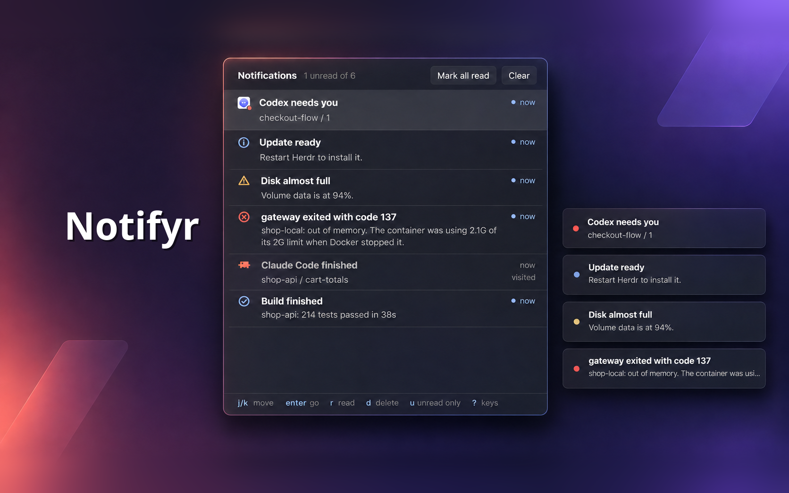

# Notifyr

A log of every notification Herdr shows, with a bell that counts the new ones and a list to read them later.



## Features

- **Every toast is kept.** Herdr's own notices and every mod's are recorded as they appear, with the time they arrived.
- **Read state per entry.** An entry is read once you click its toast or go to its space, and the list says which. The rest stay unread.
- **A list to read them.** Newest first, with the title and the whole body. A toast cuts a long body off. The list wraps it.
- **Icons that say what it was.** An agent's entry shows that agent's icon. Any other entry shows a glyph for its level: success, warning, error or info.
- **A bell with a count.** A small mark you place anywhere in your layout. It shows how many entries are unread.
- **Entries still act.** Open an entry to run what its toast would have run, such as going to the agent that needed you.
- **Vim keys.** `j` and `k` move, `enter` goes, `r` marks read or unread, `x` deletes, `u` shows unread only.
- **History that lasts.** The last 200 are kept across restarts. Clear empties the list.
- **Toasts look the same.** Notifications are drawn as Herdr draws them, including the Copy button on a machine login notice.

## Needs

- Herdr, and a layout of your own. Herdr's shipped layouts are read-only, so clone one first (`layout.clone`).
- It replaces the mod that draws notifications in that layout. Other layouts keep Herdr's and record nothing.
- It keeps its record in Herdr's shared state. It runs no programs, reads no files and uses no network.

## Install

Tell your agent:

```text
Read ~/.config/herdr-app/AGENTS.md, then add this mod: https://github.com/jbped/herdr-mods/tree/main/notifyr
```

Or by hand:

1. Copy `mods/notifyr/` to `~/.config/herdr-app/mods/`.
2. In your layout's root, add `"toast": "notifyr"`.
3. Add the bell where you want it, for example in the status row: `{ "id": "notifyr-bell", "type": "block", "size": { "px": 48 }, "content": { "mod": "notifyr", "props": { "bell": true } } }`.
4. Merge `keys.json` into `~/.config/herdr-app/keys.json`. It binds `ctrl-shift-i`.
5. Run `herdr-app check ~/.config/herdr-app/mods/notifyr`.

## Use

Click the bell or press the key to open the list. Click an entry to go to it. The buttons mark everything read or clear the list.

| Key | Action |
|---|---|
| `ctrl-shift-i` | open the list, again closes it |
| `j` / `k` | down / up |
| `enter` | go to the entry |
| `r` | mark read or unread |
| `x` | delete the entry |
| `u` | show unread only |
| `?` | every key |
| `q` or `escape` | close |

Every key, the read rules, props, the stored format and the limits: [`mods/notifyr/README.md`](mods/notifyr/README.md).
