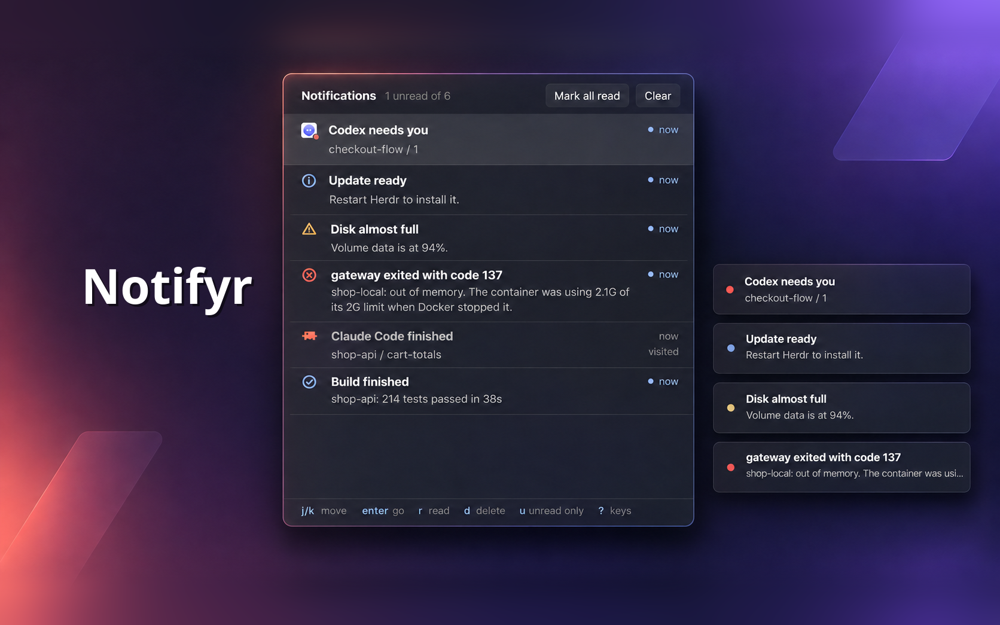

# Notifyr

A log of every notification Herdr shows. Toasts look as they always did, a bell in the layout counts the unread ones, and a dialog lists the last 200 with their whole text and vim keys. An entry is read once you click its toast or go to its space, and going to an entry from the list runs what its toast would have run.

## What you see

- **Toast**: Herdr's own, unchanged, with its plain level dot. A row on `popover` with 18px side padding and a 12px gap: an 8px level dot (or an 18px icon), a 13px semibold title in `foreground` and a 12px one-line body in `muted`, both truncated. A machine login notice shows the command and a "Copy" button on `raised`.
- **Bell**: a block the person places, 48px wide in a 28px status row. A 14px bell icon, centered, in `muted` on `chrome` with a 1px top border in `border`. With unread entries the icon and an 11.8px count beside it are `accent`. The count stops at "99+".
- **List**: a dialog 440px wide and 70% of the window high, on `popover`.
  - Header, 40px with a bottom border: "Notifications" in 13px semibold, "1 unread of 5" in 11.5px `dim` (with ", showing unread" when filtered), and the buttons "Mark all read" (only with unread entries) and "Clear" on `raised` at the right.
  - A warning line in 11.5px `working`, only when the shown layout's root does not name `notifyr` as its toast mod.
  - Rows, newest first, the only part that scrolls. Each has 14px side and 9px vertical padding and a bottom border: a 16px icon, the title in 13px semibold, the whole body wrapped in 12px, and a right column with the time in 11px.
  - The icon: the toast's own when it has one. Else, for an entry that goes to a terminal, that terminal's program icon, with a 7px corner dot in the level color (1px `popover` border) when the level is not info. Else a stroked glyph in the level color: a ticked circle for success, a triangle with "!" for warning, a crossed circle for error, a circled "i" for info.
  - An unread row: title in `foreground`, body in `muted`, a 6px `accent` dot before the time, the time in `accent`.
  - A read row: title in `muted`, body in `dim`, the time in `dim`, and under it in 10.5px `dim` how it was read: "clicked", "visited", "opened", "seen" or "read".
  - The selected row is on `selected`.
  - Legend, 28px with a top border, 11px, keys in `accent` and meanings in `dim`: "j/k move", "enter go", "r read", "x delete", "u unread only", "? keys". `?` swaps it for a wrapping list of every key on `raised`.
  - Empty: "No notifications yet.", or "Nothing unread." when filtered, centered in `dim`.

## How it behaves

- Level colors: error is `blocked`, warning is `working`, success is `done`, info is `accent`. Herdr's agent notices arrive as toasts like any other, so "needs you" and "finished" are entries too.
- A toast is recorded when it appears, with the time taken then, and with the terminal and space its action goes to. Clicking the toast runs its action and dismisses it, as before.
- Every entry starts unread. It becomes read when:
  - its toast is clicked ("clicked");
  - the person arrives at its space or focuses its terminal afterwards ("visited"). Being there already does not count;
  - the person goes to it from the list ("opened");
  - it has no action and no space, and the list opens ("seen"). It keeps its unread look until the list closes;
  - the person marks it ("read").
- A toast that times out without a click stays unread.
- The bell counts unread entries. A click opens the list.
- `ctrl-shift-i` opens the list. Again closes it.
- List keys: `j`/`down` and `k`/`up` move, `g`/`home` and `G`/`end` go to the first and last, `ctrl-d` and `ctrl-u` move 6, `pagedown` and `pageup` move 12, `enter` goes, `r` toggles read, `R` marks all read, `x` or `delete` deletes the entry, `X` deletes all, `u` toggles unread only, `?` toggles the key list, `q` or `escape` closes.
- Going to an entry marks it opened, closes the list and runs its command with the stored arguments. An entry with no action is only marked. Clicking a row does the same.
- The time reads "now", "5m", "3h", then "Nov 16". Its tooltip is `2026-11-16 14:02`. The tooltip on the read word says how and when.

## Built from

- One mod, `notifyr`, with `mod.json` `{ "place": "none", "overlay": { "kind": "dialog", "width": 440, "height": 0.7 } }`. The view is chosen in `init` from `props()`: `bell` for the bell, a `title`, `body` or `level` for a toast, otherwise the list.
- The layout: `"toast": "notifyr"` on the root, and a block `{ "mod": "notifyr", "props": { "bell": true } }`. `"bare": true` drops the bell's background and border.
- `herdr` functions: `props`, `shared`, `setShared`, `run`, `closeOverlay`, `layout`, `theme`, `checking`, `focused`, `spaces`, `panes`, `agents`. Commands: `mod.open`, and whatever each stored action names.
- Keyboard: `cx.focus_handle()` focused in `init` and again after 600 ms, `track_focus` and `on_key_down` on the list's root. `ScrollHandle` with `scroll_to_item` keeps the selected row in view.
- Visits: the bell and the list compare `focused().space` and `focused().terminal` with the last values they saw, on every render.
- Shared value `notifyr.log`: `[{ id, at, overlay, title, body, level, icon, action, terminal, space, program, read }]`, newest first, 200 at most, body cut at 600 characters. `read` is null or `{ at, how }` with `how` one of `clicked`, `visited`, `opened`, `listed`, `marked`.
- The space of an entry: `space` in the action's arguments, the `id` of a `space.*` command, the space holding the tab of a `tab.*` command or a `tab` argument, else the space of the `terminal` (from `agents()`, then `panes()` and the tab's space) or of the `pane`.
- The toast view is a copy of Herdr's `toast` mod.
- Art: `bell.svg`, one filled 16px glyph, drawn with `svg("mods/notifyr/bell.svg")`, and `icons/success.svg`, `warning.svg`, `error.svg` and `info.svg`, 24px stroked glyphs tinted by `svg()`. Program icons are Herdr's, from `terminals()[i].program` (`icon`, `tint`): `svg(icon)` in the text color when `tint`, else `image(icon)`.
- `keys.json`: `"ctrl-shift-i": "mod.open:notifyr"`.

## Watch out

- There is no API for notifications. Being the toast mod is the only way to see them, so nothing is recorded on a layout that does not name this mod, and Herdr's shipped layouts cannot be edited to name it.
- Toast props carry no time and no stable id. Take the time in `init`. A hot reload starts an open toast's copy again, so skip an entry with the same `overlay` and title from the last minute.
- `init` runs during `herdr-app check`. Return before recording or writing shared values when `checking()` is true.
- The `overlay` size in `mod.json` applies to `mod.open` only. Herdr still sizes the toast.
- `raised` is too close to `popover` to mark an unread row by its background. Use the `accent` dot.
- The list is a centered dialog. A popup at the bell was not built.
- Mark visits on arrival only, by comparing with the last focused space and terminal. Marking whenever the entry's terminal is focused undoes a hand-made "unread" at once.
- While the dialog has the keyboard `focused()` can be empty. Keep the last space and terminal then, or closing the list counts as arriving.
- A shifted letter arrives as `key: "g"` with `modifiers.shift`, and `?` arrives as `key: "?"` with no shift. Test the shifted letters before the plain ones.
- `setShared` inside `render` is avoided: the visit sweep writes from `cx.spawn`.
- `X` and Clear have no confirmation.
- Store the program on the entry when the toast appears. Looked up at draw time, the icon is lost once the terminal ends.
- Herdr's agent toasts are level info, so a level dot on every agent row is noise. Draw the corner dot for other levels only.

## Done when

- `herdr-app check` passes.
- A `notify()` with a long body shows a truncated toast, and the list shows the whole body.
- A toast whose action names a terminal in another space is unread, and turns "visited" when that space is selected.
- A toast with no action turns "seen" when the list opens.
- The bell shows the unread count.
- An entry for a terminal shows its program icon, and one with no terminal shows the glyph for its level.
- In the list, `j`, `k`, `g`, `G`, `r`, `R`, `x`, `X`, `u`, `?`, `enter` and `q` do what the legend says.
- `shared.json` holds the entries under `notifyr.log`.
