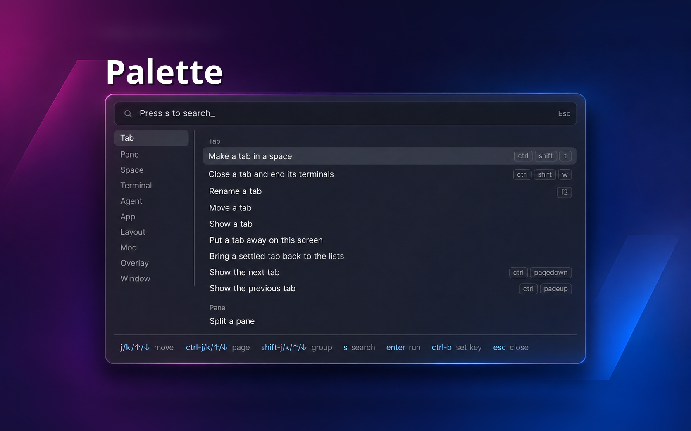

# Palette

A command palette that mods can add entries to: your entries, each mod's entries, then every Herdr command with its key.



## Features

- **Your entries.** Listed first, from `~/.config/herdr-app/palette.json`. No mod needs to change.
- **Mod entries.** A mod adds entries with a `palette` list in its `mod.json`. The other mods in this repo do.
- **Every Herdr command.** Grouped as Herdr groups them, each with its key from `keys.json`.
- **Set keys.** `ctrl-b` asks for a key for the selected entry and saves it to `keys.json`. It warns before it takes a key that is in use.
- **Filter.** Press `s` and type to filter. Every word must match. `tab` returns to the list.
- **Vim keys.** The palette opens on the list, where `j` and `k` move. `ctrl-j` / `ctrl-k` page and `shift-j` / `shift-k` jump a group. The arrows do the same with `ctrl` and `shift`.
- **Legend.** A line along the bottom lists the keys that work where the keyboard is now.
- **Group index.** A sidebar lists the groups. Click one to jump to it.
- **Arguments.** A command with required arguments asks for them first: a value, or a JSON object.

## Needs

- Herdr only.
- It reads `palette.json`, `keys.json` and each mod's `mod.json`. It writes `keys.json` when you set a key. It runs no programs and uses no network.

## Install

Tell your agent:

```text
Read ~/.config/herdr-app/AGENTS.md, then add this mod: https://github.com/jbped/herdr-mods/tree/main/palette
```

Or by hand:

1. Copy `mods/palette/` to `~/.config/herdr-app/mods/`.
2. Merge `keys.json` into `~/.config/herdr-app/keys.json`. It binds `ctrl-shift-p`, which replaces Herdr's palette. Herdr's stays in the list as `app.palette`.
3. Run `herdr-app check ~/.config/herdr-app/mods/palette`.

## Use

| Key | Action |
|---|---|
| `ctrl-shift-p` | open |
| `j` / `k`, `up` / `down` | move |
| `ctrl-j` / `ctrl-k`, `ctrl-down` / `ctrl-up` | move a page |
| `/` / `tab` | go to the search box / back to the list |
| `shift-j` / `shift-k`, `shift-down` / `shift-up` | next / previous group |
| `enter` | run |
| `ctrl-b` | set the selected entry's key |
| `q` / `escape` | close (`q` on the list), or go back from the argument prompt |

The entry format, for your own entries and a mod's, and the rules for setting keys: [`mods/palette/README.md`](mods/palette/README.md).
