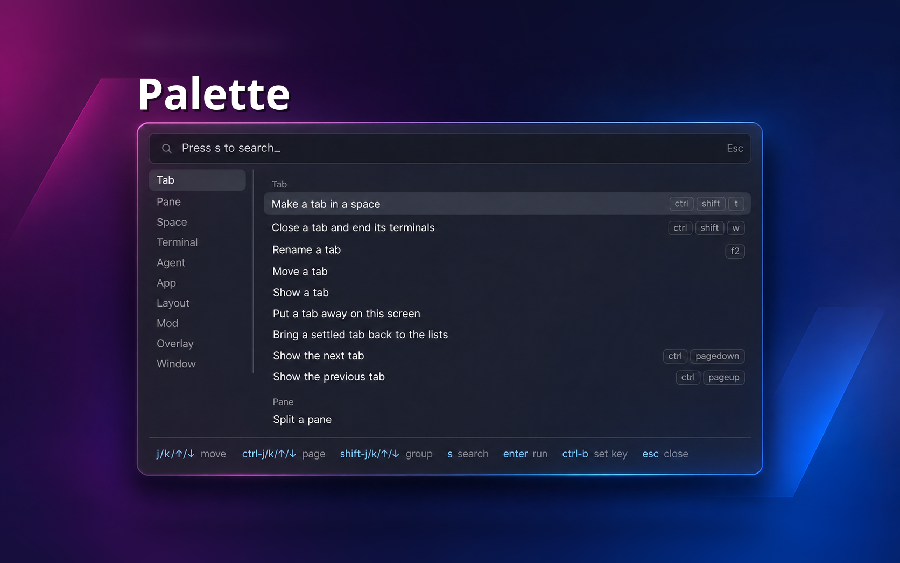

# Palette

A command palette that opens as a popup at the top of the window. It lists your own entries under Custom, then the entries other mods declare under Mods, then every Herdr command in groups (Tab, Pane, Space and so on), each with the key bound to it. It opens with the keyboard on the list. You move to a row and it runs, or press `/` and type to filter. A command that needs arguments asks for them in the same box first. `ctrl-b` sets the selected row's key.



## What you see

A popup 760px wide on `popover`, with 12px padding and a 6px gap between its parts. Top to bottom:

- **Search box**, 36px high, radius 8, on `background`, with a 1px border: `accent` while the text field or a prompt has the keyboard, `border` otherwise. Left to right: a 14px search icon in `dim`, the text field (12.8px, `foreground`, placeholder "Press / to search…"), and "Esc" in 11px `dim`.
- **Group index**, a 120px column on the left with a 1px `border` line on its right. One 24px label per group that has rows, 12px text, radius 5. The selected row's group is `foreground` on `hover`. The others are `dim`.
- **List**, right of the index, at most 360px high. It holds:
  - group headings, 26px high, 11px `dim`.
  - rows, 32px high. Each row is a 28px pill with radius 6, and the selected one is on `hover`. Left to right: the title in 13px (`foreground` when selected, `muted` otherwise, cut off with an ellipsis), the mod's folder name in 11px `dim` on a mod's entry, and the key as keycaps.
  - keycaps: one box per part of the key (`ctrl-shift-t` draws `ctrl`, `shift`, `t`), 18px high, at least 18px wide, radius 4, a 1px `border` outline, 10.5px `dim` text, 3px apart.
- With no match, the index and list give way to "No matching command" in 12px `dim`.
- **Legend**, always last, under a 1px `border` line with 8px above its text and 8px at its sides. Key hints 12px apart in 11px, wrapping: each key in `accent` semibold, 4px, then its meaning in `dim`. It follows the keyboard:
  - on the list: `j/k/↑/↓` move, `ctrl-j/k/↑/↓` page, `shift-j/k/↑/↓` group, `/` search, `enter` run, `ctrl-b` set key, `q/esc` close.
  - in the text field: `tab` list, `↑/↓` move, `ctrl-j/k/↑/↓` page, `shift-↑/↓` group, `enter` run, `ctrl-b` set key, `esc` close.
  - in the argument prompt: `enter` run, `esc` close. In the key prompt: `enter` save, `esc` close.

Group order: Custom, Mods, then Tab, Pane, Space, Terminal, Agent, App, Layout, Mod, Overlay, Window, then any other command prefix in alphabetical order. Inside a group, commands keep the order Herdr reports them in.

A Herdr command's title is the first clause of its description. A command whose first clause is longer than 60 characters or does not start with a capital letter shows its command name instead.

While it asks for arguments, the index and list are replaced by:

- the search box, now showing the command's title and "›" in 12.8px `muted` before a field with the placeholder `Value, or {"name": value, …}`.
- a 12px `muted` line: the command name, then its argument names, each optional one marked "(optional)".
- a 12px `dim` line with the command's description, or an error in `ansi1`.

While it asks for a key, the index and list are replaced by:

- the search box, showing the row's title and "›" in 12.8px `muted` before a field holding the row's current key, with the placeholder "Key, such as ctrl-shift-g. Empty removes it".
- a 12px `muted` line: "Key for", the command name and, when it has any, its arguments as JSON.
- a 12px `dim` line, "Type the key and press Enter. It is saved in keys.json and works at once.", or a message in `ansi1`.

## How it behaves

- `ctrl-shift-p` opens it with the keyboard on the list, not in the text field. The same key closes it.
- On the list, `j` and `k` move one row, `enter` runs the selected row, `/` puts the keyboard in the text field and `q` closes the palette. In the text field, `tab` puts it back on the list, and so does a click outside the field. Leaving a prompt returns the keyboard to where it was.
- Typing in the text field filters the list and selects the first row. Every typed word must appear in a row's title, command name, mod name or description. Case is ignored.
- `down` and `up` move one row. `pagedown` and `pageup` move 8 rows. `ctrl-j`, `ctrl-down` and `ctrl-d` act as `pagedown`, `ctrl-k`, `ctrl-up` and `ctrl-u` as `pageup`, `ctrl-n` as `down` and `ctrl-p` as `up`. On the list, `shift-j` and `shift-k` act as `shift-down` and `shift-up`. `shift-down` and `shift-up` select the first row of the next or previous group and put its heading at the top.
- The list scrolls only as far as the selected row needs. The mouse wheel scrolls it, and the selection moves to stay in view.
- Clicking a group in the index selects that group's first row. Clicking a row runs it.
- `enter` runs the selected row: the palette closes, then the command runs.
- A Herdr command with a required argument opens the argument prompt instead. A plain value fills the command's first argument. A whole number or decimal becomes a number, and `true` and `false` become booleans. Text starting with `{` is read as a JSON object of arguments. `enter` runs it. Bad JSON shows "Not JSON: …" and keeps the prompt open.
- `escape` closes the palette, from the list and from either prompt.
- `ctrl-b` opens the key prompt for the selected row. `enter` saves the typed key to the `global` section of `keys.json` and returns to the list, where the row shows it. The row's old key is removed. An empty field only removes it.
- The typed key is trimmed and lower-cased. Each space-separated chord must be modifiers from `ctrl`, `alt`, `shift`, `cmd`, `fn` and then one character or a key name. The first chord needs `ctrl`, `alt` or `cmd`, or is `f1` to `f24`. Anything else shows a message and saves nothing.
- A key that `global` binds to another action shows "<key> runs <action>. Enter replaces it." A key present in another section shows "<key> is also set in <sections>, which wins there." A second `enter` with the same text saves. Editing the field clears the message.
- A Herdr command with a required argument shows "A key can't fill in arguments…" and saves nothing.
- A key shows on a row when the `global` section of `keys.json` binds that exact command and arguments. Herdr commands with a required argument show no key.
- Your entries and mods' entries always run with their own fixed arguments and never ask.
- Rows have a `hover` background under the pointer. Nothing shows agent status.

Entry format, for `~/.config/herdr-app/palette.json` (a JSON list) and for a `palette` list in any mod's `mod.json`:

```json
[
  { "title": "Split down", "command": "pane.split", "args": { "direction": "down" }, "about": "Open a terminal below the focused pane" },
  { "title": "Open Notes", "command": "mod.open", "args": { "name": "notes" } }
]
```

`title` and `command` are required. `args` defaults to `{}`. `about` is only searched, never drawn.

## Built from

- `mods/palette/mod.json`: `{ "place": "none", "title": "Palette", "overlay": { "kind": "popup", "at": "top", "offset": 40, "width": 760, "height": 0.7 } }`.
- `mods/palette/main.js`: one `View`, no `props` roles. It reads `props().overlay` only to close itself.
- `mods/palette/README.md`: install steps and the entry format.
- `keys.json` in the share: `{ "global": { "ctrl-shift-p": { "command": "mod.open", "args": { "name": "palette" } } } }`.
- Herdr functions: `appHome`, `commands`, `readTextFile`, `writeTextFile`, `run`, `props`, `closeOverlay`, `theme`.
- Other built-ins: `readdir` from `fs/promises`, `InputState` and `Input` from `gpui-base`, `cx.spawn`, `cx.timer.after`, `cx.focus_handle`, `console.log`.
- Commands: `mod.open` (from the key), plus whatever command the picked row names, through `run(name, args)`.
- Programs: none. Network: none.
- Files read outside its folder, all under `appHome()`:
  - `palette.json`: your entries, group "Custom".
  - `mods/` (listed with `readdir`, sorted by name) and each `mods/<name>/mod.json`: the `palette` list, group "Mods", each row tagged with `<name>`.
  - `keys.json`: the `global` section only.
- Files written: `keys.json` under `appHome()`, only from the key prompt. It is read again at save time, changed as parsed JSON and written with `writeTextFile(path, text, expected)` so a file changed in between is refused. Output is `JSON.stringify` with two spaces, keeping the file's final newline and CRLF line ends. An entry with arguments is written as `{ "command", "args" }`, one without as the command name.
- Art: `mods/workspace-chrome/search.svg`, from Herdr's shipped `workspace-chrome` mod. Theme tokens only: `popover`, `background`, `accent`, `border`, `hover`, `foreground`, `muted`, `dim`, `ansi1`.
- Rows come from `commands()`: `name`, `about` and `args` (each with `name` and `required`). The group is the part of `name` before the first `.`, capitalised.
- Key lookup: each `global` binding becomes a signature of command name plus JSON arguments with sorted keys. A string action `name:value` fills the command's first argument. An object action `{ "command", "args" }` is used as is. The first key found for a signature wins.
- The list is one `relative`, `overflow_hidden` box. Headings and rows are placed with `absolute` at fixed y (26px and 32px steps) minus the scroll offset, and only those in view are drawn.

## Watch out

- Herdr's own command labels are not available to mods. The title is cut from `about` at the first ` (`, `: `, `; ` or `. `.
- The mod is created anew on each open, so entries and keys are reread every time. No watcher is needed.
- The mod focuses its own handle (the list) in `init` and again after 600 ms, unless the text field or a prompt has taken the keyboard. Keep both calls.
- The text field's `focus` and `blur` events set whether it has the keyboard. The field handles `tab` itself after the mod's key handler, which leaves the keyboard nowhere, so the `blur` handler focuses the list 30 ms later.
- `/` pressed on the list does not end up typed in the field.
- Arrow and page keys are handled in `on_key_down` on the root, which calls `cx.stop_propagation()` for the keys it handles.
- After a wheel scroll the selection must be moved into view. Otherwise the next render scrolls back to it.
- `mod.json` gives `height` as 0.7 and the list caps itself at 360px, so the popup's real height comes from its content.
- A `palette.json` that is not valid JSON is left out and the reason goes to `console.log`. A mod with a broken `mod.json` is left out silently. An entry without `title` or `command` is dropped.
- Keys bound in `layout:<name>`, `terminal` or `mod:<name>` sections are not shown, and the key prompt never changes them.
- Herdr runs its global keys before a mod gets them, so the key prompt takes typed text and cannot record a pressed key. `ctrl-b` and the `ctrl` movement keys reach the mod only while nothing in `keys.json` binds them. Plain `j` and `k` type into the filter, so they cannot move.
- Herdr closes a popup on `escape` itself, so `escape` in a prompt closes the palette.
- A key name ending in `--` (a binding on the minus key) draws `-` as its last keycap.
- `ctrl-shift-p` is Herdr's own palette key. Merging `keys.json` replaces it, so ask first. Herdr's palette stays in the list as `app.palette`.
- A failed `run` is logged to `console.log`. The palette has already closed and shows no error.
- It needs the shipped `workspace-chrome` mod for the search icon.

## Done when

- `herdr-app check ~/.config/herdr-app/mods/palette` passes.
- `mod.open {"name": "palette"}` shows the popup with the search box border in `border`, and running it again closes it.
- The legend starts with `j/k` on open, with `tab` after `/`, and reads `enter` save, `esc` close in the key prompt.
- `j`, `j`, `k` selects the second row. `/`, some text, `tab`, then `j` moves the selection and leaves the text unchanged.
- With the `palette.json` above in place, the list starts with a Custom group holding "Split down" and "Open Notes".
- A mod whose `mod.json` has a `palette` list shows its entries under Mods with the mod's folder name on each row.
- The row for `tab.new` shows the keycaps of the key that `keys.json` binds to it.
- Typing two words leaves only rows that contain both.
- `shift-down` moves the selection to the first row of the next group, and the index marks that group.
- Picking a command with a required argument shows the argument prompt. Typing a value and `enter` runs it.
- `ctrl-j` or `ctrl-down` moves 8 rows down and `ctrl-k` or `ctrl-up` 8 rows up. `shift-j` on the list selects the first row of the next group.
- `ctrl-b` on a mod's entry, then `ctrl-shift-g` and `enter`, adds that key to `global` in `keys.json`, the row shows its keycaps, and pressing the key runs the entry.
- Typing `ctrl-shift-t` there shows "ctrl-shift-t runs tab.new. Enter replaces it." and leaves `keys.json` unchanged until the second `enter`.
- `ctrl-b`, an emptied field and `enter` removes the row's key from `keys.json`.
