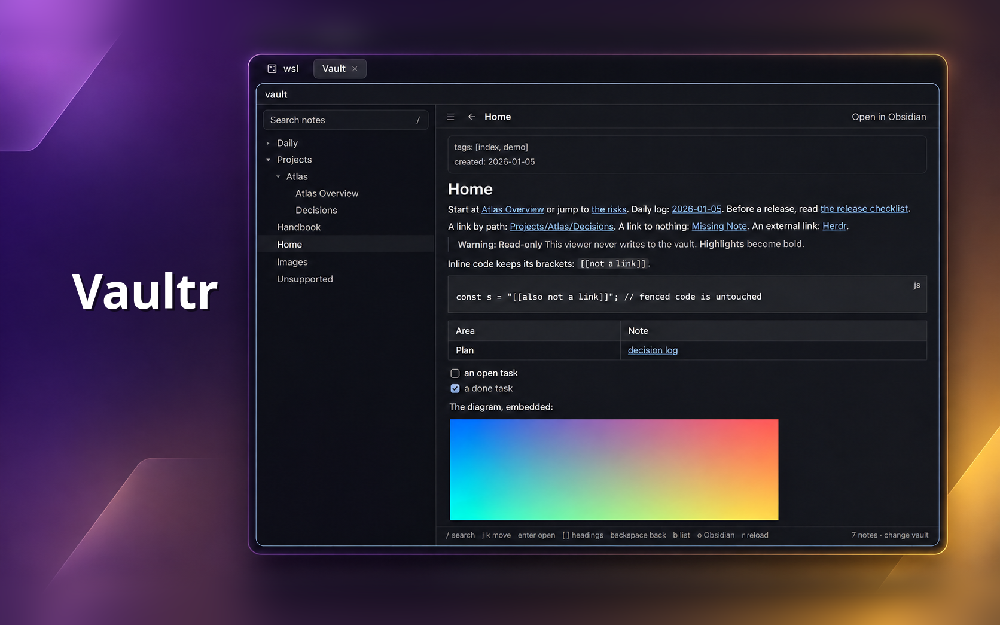

# Vaultr

Read your Obsidian vault inside Herdr: the folder tree, name search, links that open in place, images and backlinks.



## Features

- **Notes as Obsidian shows them.** Wikilinks, aliases, callouts, highlights, tables, task lists, code and the properties block all draw. The mod never writes to the vault.
- **Links open in place.** Click a wikilink or a link to another note and it opens here, at the heading when the link names one. Back returns to the note before.
- **Folder tree and search.** The vault's folders, with a search box that filters notes by name and path as you type. Breadcrumbs above the note show where it lives.
- **Several vaults.** Save more than one vault and switch between them with a key. Each one opens on the note you left it on.
- **Images.** Embedded and linked PNG, JPEG, GIF, WebP and SVG files draw in the note.
- **Backlinks.** Every note lists the notes that link to it.
- **Live.** A note redraws when Obsidian or an agent saves it, and new notes appear in the tree.
- **Four places.** Open it as a dialog over the window, as a tab, beside the pane you are working in, or in your layout's side panel. A narrow one shows the note alone.
- **Keyboard.** Every action has a key, and the dialog opens on the note you closed it on.
- **Open in Obsidian.** One key or click opens the note you are reading in Obsidian to edit it.

## Needs

- Herdr on Windows, macOS or Linux. Only Windows has been tested.
- A vault inside your home folder. Herdr does not let a mod read files outside it.
- It reads every note in the vault you are reading. It copies the images you view to `~/.config/herdr-app/data/vaultr/`, and runs `robocopy` (Windows) or `cp` (macOS, Linux) to do it.
- It runs your system's opener (`rundll32`, `open` or `xdg-open`) for web links, other files and Open in Obsidian. It uses no network itself.
- It binds `ctrl-shift-y`. Check that your `keys.json` does not already use it.

## Install

Tell your agent:

```text
Read ~/.config/herdr-app/AGENTS.md, then add this mod: https://github.com/jbped/herdr-mods/tree/main/vaultr
```

Or by hand:

1. Copy `mods/vaultr/` to `~/.config/herdr-app/mods/`.
2. Merge `keys.json` into `~/.config/herdr-app/keys.json`. It binds `ctrl-shift-y`.
3. Run `herdr-app check ~/.config/herdr-app/mods/vaultr`.

## Use

Press `ctrl-shift-y`. The first time, type or browse to your vault folder. "vaults" at the bottom right adds more. Click a folder to open it, a note to read it and a link to follow it.

| Key | Action |
|---|---|
| `ctrl-shift-y` | open the dialog, or close it |
| `/` | search notes by name |
| `j` / `k`, `down` / `up` | move in the list |
| `enter` | open the note, or open and close the folder |
| `}` / `{` | next / previous heading |
| `backspace` | back to the note before |
| `]` / `[` | switch to the next / previous vault |
| `o` | open the note in Obsidian |

Every key, the tab and pane commands, what is not drawn and the limits: [`mods/vaultr/README.md`](mods/vaultr/README.md).
