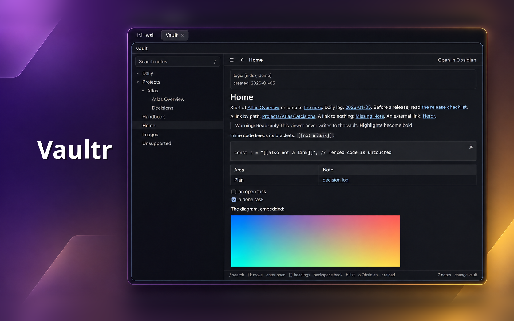

# Vaultr

A read-only reader for an Obsidian vault. On the left, the vault's folders and a search box. On the right, the note: its properties, its text with links that open in place, its images, and the notes that link to it. It opens as a dialog, a tab or a pane beside a terminal, and the note redraws when its file changes.

## What you see

Two columns on `background`, 13px text.

- **List**, 260px wide on `chrome`, with a 1px `border` line on its right.
  - Search box: 30px high, 8px from the edges, radius 6, a 1px border (`accent` while it has the cursor, else `border`) on `background`. Placeholder "Search notes", 12.5px. A "/" in 11px `dim` at its right.
  - Rows, 24px high. Indent 10px plus 12px per level. A 10px column holds "▾" for an open folder, "▸" for a closed one, nothing for a note. Then the name, cut off with an ellipsis. Folders come before notes at every level, both sorted without regard to case.
  - Text is `muted`. The note on screen is `foreground` on `selected`. The row the keyboard is on is `foreground` on `hover`.
  - With a search, the rows are the matching notes as paths without `.md`, no folders. With no match: "No notes match." in `dim`.
- **Note column**, the rest of the width.
  - Bar, 32px high with a 1px `border` line below: "☰" (show or hide the list), "←" (back to the note read before this one, `dim` when there is none), breadcrumbs (each folder above the note in 12px `muted`, "›" between them in `dim`, then the note's name in semibold; a narrow copy shows "…" and the last folder only), "Open in Obsidian" at the right, and "✕" when it is a dialog.
  - A notice strip on `surface` when there is one: an error in `blocked`, a note such as `No note named "X".` in `muted`.
  - The note, scrolling, 16px side padding, 10px between parts: the properties box (`surface`, 1px `border`, radius 6, 12px `muted`, one line per frontmatter line), then the text, with each image as its own block at most 720px wide with radius 4. A missing image is one `blocked` line: "Missing image: name".
  - Under a 1px `border` line: "BACKLINKS (n)" in 11px `dim`, then one `accent` line per linking note. While the vault is still being read it says "BACKLINKS (reading the vault…)".
  - Footer, 28px high, 11px: the legend at the left, "<vault folder name> · N notes · vaults" in `dim` at the right. The legend is key and meaning pairs, the key in `accent` and the meaning in `dim`, 14px apart: `j/k` move, `enter` open, `/` search, `[ / ]` heading, `v` vault, `?` keys.
  - After `?`, a block above the footer on `raised` lists every key the same way, wrapping, and the footer's legend is empty. `?` again, or a heading jump, hides it.
- **Vaults form**, in place of both columns when no vault is set or after "vaults": centered, "Choose your Obsidian vault" (or "Vaults") in 16px semibold, one `muted` line, one 30px row per saved vault (folder name in semibold, path in 12px `muted`, a ✕ at the right, the current one on `selected`), a path field with a "Use" button ("Add" when a vault is saved), "Browse…" below (and "Cancel" when a vault is set), and an error line in `blocked`.

Narrower than 620px there is one column: the list or the note. The list then has a 32px row above the search box, "← Back to <note name>" in `muted` with a 1px `border` line below, which shows the note again.

## How it behaves

- It shows no agent status.
- Clicking a folder opens or closes it. Clicking a note opens it. Open folders and the last note are remembered per vault.
- Opening a note starts it at the top, opens its folders in the list, and in a narrow copy hides the list.
- Clicking a breadcrumb folder shows the list with that folder open and the keyboard on it.
- Clicking a link: a note opens in place, at the heading when the link names one. A missing note shows the notice. A file that is not a note, and a web link, open in the system's default app.
- Typing in the search box filters by every word, on the path, with notes whose name matches first, 200 at most.
- Keys, while the mod has the keyboard: `/` search, `j`/`k` or arrows move, `enter` open, `l`/`h` or right/left open/close a folder, `]`/`[` next/previous heading, `backspace` back, `v`/`shift-v` next/previous vault, `b` list, `o` Obsidian, `r` reload, `escape` leave or clear the search.
- When anything under the vault changes, the folders are read again, the open note is redrawn, and backlinks are rebuilt. Changes only inside `.obsidian/` are ignored.
- "vaults", the `vaultr.vault` command, and the first run show the vaults form. `enter` or the button takes the typed path, adds it to the saved vaults and switches to it. "Browse…" opens the system's folder picker. Clicking a saved vault switches to it. Its ✕ drops it from the list, and when it was the current one the first vault left becomes current.
- `v`, and the `vaultr.next` command, switch to the saved vault after the current one, going round. `shift-v` and `vaultr.prev` go the other way. With one vault saved they show "One vault is saved. Add another with "vaults" at the bottom right." A switch restarts the copy on the other vault, on the note that vault last showed.

## Built from

- `mods/vaultr/mod.json`: `place` "none", `focusable` true, `overlay` `{ "kind": "dialog", "width": 1100, "height": 0.85 }`, and eight `palette` entries (open as dialog, tab, pane, side panel; next vault; previous vault; vaults; reload). The side panel entry sends `tabs-plus.vaultr` and needs the setup in the mod's README.
- `mods/vaultr/main.js`: one `View`. Props: `vault` and `note`, both optional, and `overlay` from Herdr.
- `mods/vaultr/md.js`, no Herdr imports: splits frontmatter, and turns the body into segments, `{type: "md", text, heading?}` or `{type: "image", target}`. A heading line starts a new segment. Wikilinks and relative markdown links become `[label](vaultr://open/<encoded target>)`. Callout first lines become bold. Fenced code and code spans are left alone.
- `mods/vaultr/vault.js`, no Herdr imports: `makeIndex(files)`, `resolve(index, name, from)`, `rows(index, open, query)`, `vaultKey(path)`, `vaultList(saved, current)`, `nextVault(list, current, by)`.
- `mods/vaultr/platform.js`: `openExternal(url)` and `copyFile(fromDir, toDir, name)`.
- `keys.json` in the share: `{ "global": { "ctrl-shift-y": "mod.open:vaultr" } }`.
- Herdr functions: `props`, `theme`, `appHome`, `watchFolder`, `checking`, `nextCommand`, `shared`, `setShared`, `pickFolder`, `closeOverlay`, `exec`, `window`.
- Other built-ins: `readdir`, `readFile` and `exists` from `fs/promises`; `TextView.markdown` with `on_link_click`, `InputState`, `Input` and `ScrollHandle` from `gpui-base`; `image` from `gpui-kit`; `localStorage`; `cx.spawn`, `cx.timer.after`, `cx.focus_handle`.
- Shared state: `vaultr.vault`, the current vault folder with `/` separators, and `vaultr.vaults`, the array of saved vault folders. A vault set before the list existed counts as saved. `localStorage`: `note:<vault>` and `open:<vault>`.
- Programs: `robocopy` on Windows, `sh` with `mkdir` and `cp` elsewhere, to copy an image. `rundll32 url.dll,FileProtocolHandler`, `open` or `xdg-open` to open a URL. Network: none.
- Files read: every file name under the vault, and every `.md` file. Files written: image copies under `<appHome>/data/vaultr/<vaultKey>/`, at the image's path below the vault.
- Each markdown segment is its own `TextView.markdown(id, text).selectable(true)`, with the note's version in the id. Segments and images are direct children of the scroll area, so `ScrollHandle.scroll_to_item` can reach a heading.
- Open in Obsidian is `obsidian://open?path=<encoded absolute path>`.
- Theme tokens only. Art: `vault.svg`, a book outline for a side panel button. The mod itself does not draw it.

## Watch out

- `image()` draws nothing for a path outside the app's folder (the log says "invalid format"). Copy the file under `appHome()` and pass the path relative to it.
- `fs.writeFile` with a `Uint8Array` writes a 0-byte file and reports no error. Copy binary files with a program.
- `TextView.markdown` draws nothing for ``. Images must be split out of the text.
- `fs` reads only inside the home folder. For a path outside it, `fs.exists` throws at the call instead of rejecting, so wrap it in `try`.
- A clicked link's text view is removed when the note changes, and the keyboard goes with it. Focus the mod's own handle in the link handler.
- `scroll_to_item` scrolls as little as it can, so a heading below the view lands at the bottom edge. To put it at the top in one step, draw an empty child as tall as the view in front of the heading's segment, give the segment a top margin of minus that height and the gap, and scroll to the empty child. The negative margin on the empty child's own bottom edge does not work: nothing scrolls. Two scrolls a frame apart flicker.
- A new note needs a new scroll area id and a new `ScrollHandle`, or it opens at the old note's scroll position.
- Read the vault's links after the first note is drawn. It takes about 18 ms a note.
- In a dialog, `escape` closes the dialog before the mod sees the key.
- `robocopy` exits with 1 after a copy and 0 when the file was already there. 8 and above are failures.
- A copy with `props.vault` ignores the shared vault. Every other copy restarts when `vaultr.vault` changes, by comparing it in `render`.
- The folder picker and the three opener programs were not run in testing, and nothing was run on macOS or Linux.

## Done when

- `herdr-app check ~/.config/herdr-app/mods/vaultr` passes.
- `sh vaultr/tests/run.sh` passes.
- With no vault set, the folder form shows. A path outside the home folder shows "… is outside your home folder, which is all Vaultr can read."
- With `tests/fixture` copied into the home folder and chosen, the list shows Daily and Projects above Handbook, Home, Images and Unsupported.
- In Home, clicking "Atlas Overview" opens that note, and `backspace` returns to Home at its top.
- In Home, clicking "the release checklist" opens Handbook with "Release checklist" at the top of the view.
- Images shows five pictures (PNG, JPEG, GIF, SVG, a markdown image), "Missing image: nowhere.png", and the picture whose file name has a space.
- Saving a change to an open note redraws it within a few seconds, and a new note appears in the list.
- `/`, typing `dec`, `enter` opens Decisions.
- With a second vault added in the vaults form, `v` switches to the other vault and back, each on the note it last showed, and the footer names the vault.
- `mod.open {"name": "vaultr"}` shows the dialog on the last note read, and running it again closes it.
- In a pane narrower than 620px the note shows alone, and `b` shows the list.
