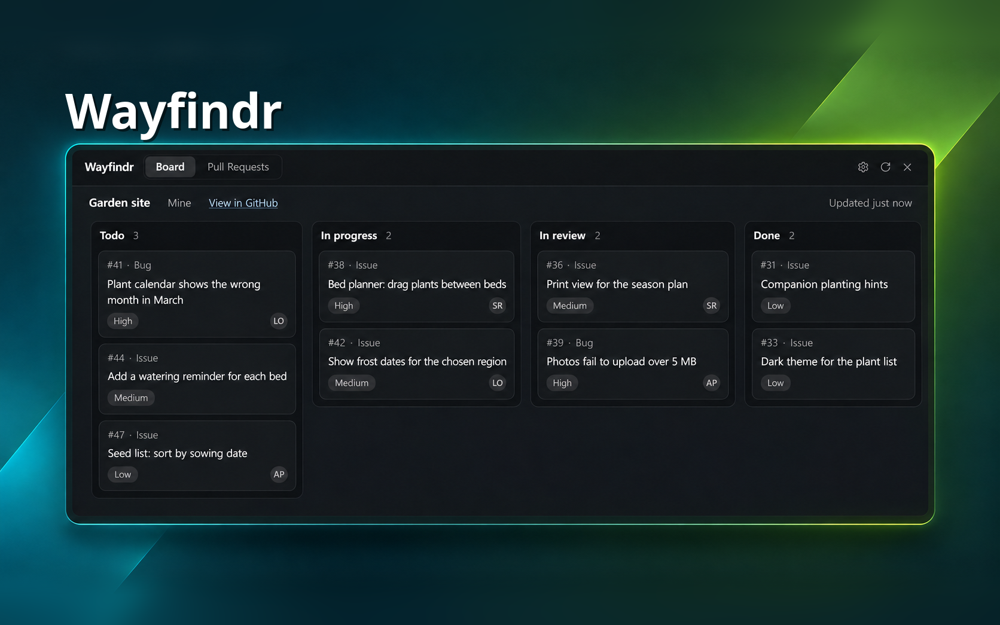

# Wayfindr

Your Boards and Pull Requests from GitHub, Azure DevOps and ClickUp inside Herdr, with a space started from a Ticket or a Pull Request.



## Features

- **Boards.** GitHub Projects, Azure DevOps team boards and ClickUp lists as kanban Columns. "Mine" shows only the Tickets assigned to you.
- **Ticket detail.** A panel with the description, acceptance criteria, comments and linked Pull Requests. Edit the title, post a comment, or move the Ticket to another Column.
- **Pull Requests.** Your open Pull Requests and the ones that ask for your review, across every repo, with their checks.
- **Pull Request detail.** The files with their diffs, review threads and checks. Mark files viewed, comment on lines, reply to threads and post a review.
- **Launch.** Start a space from a Ticket: a worktree for each repo it touches, and an agent that gets the Ticket as its first message.
- **Review.** Start a space on a Pull Request's branch in its own worktree, with an agent and a pane that shows the Pull Request beside it.
- **Profiles.** Several sets of Accounts, Boards and Repos, such as work and personal. One shows at a time.
- **Background checks.** A toast for each Pull Request that newly asks for your review and each Ticket newly assigned to you.
- **Settings.** A screen that edits Profiles, Accounts, Boards, local clones and Pull Request repos, so you rarely edit the file by hand.
- **Vim keys.** Optional letter keys for every action, with a legend and `?` for the keys that work now.

## Needs

- A layout of your own with a `wayfindr` block, and the [tabs-plus](../tabs-plus/) mod for its tab bar button.
- `gh` for GitHub, `az` for Azure DevOps, or a token in an environment variable for ClickUp or an Azure PAT. `git` for Launch, Review and local diffs.
- It runs `gh`, `az` and `git`, and calls the GitHub, Azure DevOps and ClickUp APIs. It stores no secrets.
- It reads and writes `data/wayfindr.json`, its caches and saved comments under `~/.config/herdr-app/data/`, and adds worktrees to your clones.
- Posting a comment, a review, a Move or a title edit changes the Ticket or Pull Request for everyone.

## Install

Tell your agent:

```text
Read ~/.config/herdr-app/AGENTS.md, then add this mod: https://github.com/jbped/herdr-mods/tree/main/wayfindr
```

Or by hand:

1. Copy `mods/wayfindr/` to `~/.config/herdr-app/mods/`.
2. In a layout of your own, add `{ "id": "wayfindr", "type": "block", "content": { "mod": "wayfindr" }, "hidden": true }` to the `work-body` row, after `panel`.
3. Install [tabs-plus](../tabs-plus/) and point the layout's `tabs` block at it.
4. Merge `keys.json` into `~/.config/herdr-app/keys.json`. It binds `ctrl-shift-j`.
5. Create `~/.config/herdr-app/data/wayfindr.json` (format in the reference), then sign in with `gh auth login` or the `az login` command Wayfindr shows.
6. Run `herdr-app check ~/.config/herdr-app/mods/wayfindr`.

## Use

Open it with `ctrl-shift-j` or the Wayfindr button in the tab bar. It covers the terminals until you close it. Click a card or a Pull Request row to open it. The letter keys below need **Vim keys** ticked in Settings.

| Key | Action |
|---|---|
| `ctrl-shift-j` | show or hide Wayfindr |
| arrows, `enter` | move, open |
| `tab` | the other view: Board or Pull Requests |
| `shift-left` / `shift-right` | move the card one Column |
| `esc` | close this layer, then hide Wayfindr |
| `j` / `k`, `h` / `l` | move in a Column, previous / next Column |
| `a` | Launch from a Ticket, Review from a Pull Request |
| `?` | every key that works now |

Every key, the `wayfindr.json` format, sign-in, templates and worktree placement: [`mods/wayfindr/README.md`](mods/wayfindr/README.md).
